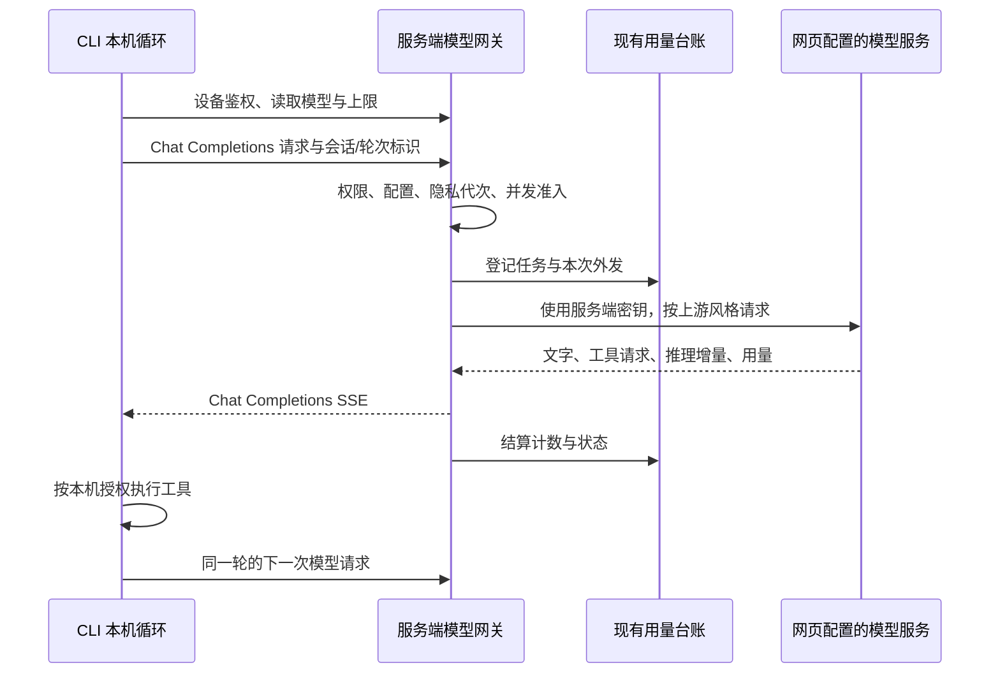

# CLI 服务端模型网关：设计

状态：Shape 待审阅（2026-10-19），不作为已经实施的说明。对应 [brief](../comet/specs/cli-model-gateway/brief.md)、[spec](../comet/specs/cli-model-gateway/spec.md)，遵循[开发工作流](../development/development-workflow.md)。以 brief U1–U4 的建议默认值为设计基线；本次仅新增文档，公共 API、migration、测试和部署配置均在 Build 实施。

## 1. 现状与复用边界

以下入口已在当前工作树核对，后文标为“拟新增”的名称尚不存在。

| 现有位置 | 已有行为与本次衔接 |
| --- | --- |
| `clients/cli-go/internal/modelclient/core.go`、`packages/agentcore/modelclient/{client,stream,types}.go` | CLI 是共享 Chat Completions 客户端的别名封装，已有流式、推理展示、流式选项／非流式兼容回退。注入 CLI HTTP transport 与宿主适配器，不修改共享请求／响应协议。 |
| `clients/cli-go/internal/command/agent.go` 的 `modelDependencies`、`agentDependencies` | 当前先读本地模型配置和钥匙串，完整 agent 还要求设备凭据。需在装配入口选择网关／直连，不能只改 Base URL。 |
| `clients/cli-go/internal/config/config.go`、`internal/modelsecret`、`internal/credentials`（后两者相对 `clients/cli-go`） | 配置严格解码；模型密钥与设备令牌分开保存。新增路由状态不能让旧 CLI 无法读取原配置，也不能把设备令牌误存为供应商密钥。 |
| `server/internal/settings/service.go` 的 `TeachingClient`、`MentorUsageClient`、`mentorClient`、`usageTransport`、`modelClient` | 已集中读取配置、持有密钥、固定配置指纹并装配调用。教学配置在重启时冻结，导师配置每次读取当前有效槽位；网关跟随后者的选槽规则，不能另读一份环境配置。 |
| `server/internal/settings/network.go` 的 `modelTransport`、`rejectRedirect` | 复用服务端精确端点允许列表、禁重定向和不继承环境代理的策略；不是把外部 URL 交给通用反代。 |
| `server/internal/integrations/llm/{client,responses}.go` | 已有 Chat Completions／Responses 路径、结构化请求和 usage 解析，但 `Chat` 使用 `stream:false`，尚无通用工具流转换。`settings.Service.validate` 也只允许 teaching 槽位选 Responses。 |
| `server/internal/mentorrun/core.go` 的 `budgetTransport.RoundTrip` | 名称仍带 budget，实际还承担身份、隐私、目的地与台账门禁；不能整段删除或直接绑定一个虚构 mentor run 来复用。 |
| `server/internal/modelusage/{store,transport,observe,query}.go` | 已有 `BeginTx`／`Dispatch`／`Observe`／`Finish`／`RecoverTx`；`Transport` 对同步外发记账，导师 transport 自行记账。一个上游出口只能装配其中一层。 |
| `server/internal/mentorrun/worker.go` 的 `claim` | 当前按有效 run 租约限制并发，事务 advisory lock 为 `210021`。同步模型出口尚无统一的同池准入；网关不能只另建进程内 semaphore。 |
| `server/internal/transport/httpapi/model_usage.go` | 已有汇总、任务和调用查询，但查询参数尚无 source／actor_device_id，Task DTO 也未展示设备。不能把“表里已有字段”写成筛选已完成。 |
| `server/migrations/000041_model_usage.sql` 至 `000048_studio_conversation_scope.sql` | 台账已具有 source／actor_device_id、可空 Token 和调用状态；当前最新序号为 000048。 |

选择“现有模型配置工厂 + 服务端协议适配 + CLI 路由适配器”。另建供应商客户端会重复安全和记账逻辑；直接给 CLI 配置与密钥会破坏已确认边界，均不采用。仅新增网关应用编排，不建设另一套模型设置、密钥存储或用量系统。

## 2. 架构和数据所有权



- identity 拥有设备、令牌和 scope；settings 拥有模型配置、密钥和共享上限。
- learning privacy owner 拥有台账，以及新增的 CLI 轮次归属、请求去重和运行租约元数据；接入现有 `learning_typed_payload` 清除及残留检查。
- CLI 拥有会话正文、本机工具结果、工具审批和执行恢复。服务端没有 CLI conversation/message 表，不创建导师 run 保存这些内容。
- 一次网关调用仅在内存中持有转发所需正文；请求结束即释放。跨请求仅保留计数与标识，不保留完整请求、回答、工具参数、推理正文或可重放的内容缓存。

## 3. 公共 API 草案

以下均为拟新增合同。协议版本 `1`；只接受已配对服务端的 HTTPS（本机开发沿用已有显式 HTTP 例外），设备令牌放 `Authorization: Bearer …`，不放 URL。CLI 拒绝跳转，不能将令牌或正文转发给另一 origin。除首次读取配置外，网关请求均携带协议版本与隐私代次 header；状态／取消也不能跨代次操作旧请求。

### 3.1 配置与能力

`GET /v1/model-gateway/config`：有效设备身份即可读取最小安全投影，不要求 `settings:*`；调用权限在 `invoke_allowed` 单独说明。Web cookie 不能用于模型网关请求。此 GET 不调用供应商，不产生模型用量。

```json
{
  "protocol_version": 1,
  "invoke_allowed": true,
  "available": true,
  "unavailable_reason": null,
  "configuration_revision": "opaque-revision",
  "privacy_generation": 7,
  "model": "server-default",
  "model_name": "configured-model",
  "limits": {
    "context_tokens": 32768,
    "output_tokens": 2048,
    "max_tool_steps": null,
    "idle_timeout_seconds": 60,
    "request_timeout_seconds": 900
  },
  "capabilities": {"stream": true, "tools": true, "reasoning_deltas": true},
  "admission": {"per_device": 1, "cli_capacity": 1, "queue": false}
}
```

`null` 工具上限代表不限；reasoning_deltas 表示可转发上游实际提供的增量，不保证模型一定生成。`available:false` 的原因枚举为 `model_not_configured`、`model_disabled`、`upstream_incompatible`、`gateway_capacity_disabled`。繁忙是即时请求结果，不缓存为配置不可用。

选槽等同当前 `mentorClient`：`MentorUsesTeaching` 为真取 teaching，否则取 mentor。使用该槽位当前保存且已生效的连接配置，复用其端点授权和密钥加载；不从启动时冻结的 `TeachingClient` 偷换配置。CLI 不收到端点、密钥、允许列表或含秘密的内部 configuration 指纹。`configuration_revision` 是安全的不透明版本，绑定有效配置与 limits；服务端另保留是否改变模型目的地的判断。

### 3.2 模型请求

`POST /v1/model-gateway/chat/completions`，需 `model:invoke`。共享客户端的 Base URL 为 `/v1/model-gateway`，仍由它追加 `/chat/completions`。

CLI 宿主适配器补充必填 header，不向 agentcore 请求结构增加字段：

| Header | 含义 |
| --- | --- |
| `X-Model-Gateway-Version: 1` | 明确协议版本；未知版本不外发。 |
| `X-Model-Configuration` | 上次读取的安全配置版本。 |
| `X-Learning-Generation` | 配置读取时的隐私代次，防旧轮次跨清除重放。 |
| `X-CLI-Session-ID` | 随机 UUID，本机会话的用量关联，不是网页会话 ID。 |
| `X-CLI-Turn-ID` | 随机 UUID，一次用户输入开始的新轮次；继续沿用。 |
| `X-CLI-Request-ID` | 随机 UUID，一次逻辑模型请求的去重身份。 |
| `X-CLI-Model-Stage` | 白名单 `foreground`／`context_observer`／`context_reflector`／`tool_limit_summary`／`probe`，不得接受自由文本。 |
| `X-Learning-Space-ID`（可选） | 沿用学习区 header；校验权限并固定本轮归属，不接受任意正文中的 space_id。 |

```json
{
  "model": "server-default",
  "messages": [{"role": "user", "content": "请检查这个文件"}],
  "tools": [{"type": "function", "function": {
    "name": "read_file", "description": "读取本机文件",
    "parameters": {"type": "object", "properties": {"path": {"type": "string"}}}
  }}],
  "max_tokens": 2048,
  "reasoning_effort": "auto",
  "stream": true,
  "stream_options": {"include_usage": true}
}
```

服务端明确校验现有共享客户端能产生的字段。messages 为文本及 function tool calls/results；不接收多模态、供应商托管工具、任意 headers、URL、API key、`previous_response_id`、`store` 或任意其他代理参数。`model` 仅接受 `server-default`，实际模型由配置确定。`max_tokens` 缺省取服务端值，有值时须为正且不超过服务端上限，不能静默扩大；请求文本、工具定义和输出预留合计不能已知超窗。

建议请求体上限 16 MiB，先在有界内存中完整校验再外发，超过返回 413。与共享核心复用上下文估算规则和安全余量，不将估算当实际 usage；供应商拒绝上下文仍如实报错。流式帧、工具参数及最终回答沿用共享客户端边界，不能靠网关扩大本机协议接受范围。

`stream:false` 返回普通 Chat Completions `choices[0].message`、`finish_reason` 及已知 usage。成功响应头含 `X-CLI-Request-ID`、`X-Model-Usage-Task-ID`、`X-Model-Gateway-Version`，不含上游敏感 header。

配置不匹配在外发前返回 409。CLI 刷新后，仅 limits 改变可重新规划并提交尚未外发的请求；有效模型或目的地改变时先告知并等待用户确认。进行中的请求使用冻结配置，下一次请求重新比较，不在一条流中途换模型。

### 3.3 状态与取消

- `GET /v1/model-gateway/requests/{request_id}`：仅原设备、当前代次、具备 `model:invoke` 可读；不存在、其他设备或已清除返回同样的 404。返回 `{request_id, task_id, state, dispatched, usage, reason}`，不返回正文。state 为 `accepted`／`running`／`succeeded`／`failed`／`cancelled`／`outcome_unknown`；usage 沿用可空 Token 口径。请求中发生多个上游尝试时返回已知合计、未知次数，不伪装单次完整值。
- `POST /v1/model-gateway/requests/{request_id}/cancel`：相同权限，空 JSON 请求体；返回 200 `{request_id,state:"cancelled"}`。对终态幂等返回已有终态；取消先于请求到达时可登记原设备范围内的取消标记，后到 POST 不得外发。此标记没有 task/call，不计调用。
- 取消先在权威状态中禁止继续，再通知运行实例关闭上游连接。GET 是核对入口，不是续流入口；不提供响应重放或 `Last-Event-ID` 恢复。
- CLI Ctrl-C 首先取消本地 HTTP context；能联网时补发一次幂等 cancel。断线后可查询状态；查询不到或上游结果未知时不把它解释为“没有消耗”。

### 3.4 SSE 与错误

成功流采用 `Content-Type: text/event-stream`、`Cache-Control: no-store`、`X-Accel-Buffering: no`。不引入要求 agentcore 认识的自定义成功事件；chunk 使用单个 `choices[0]`，index 为 0。

| SSE 帧 | 内容与完成规则 |
| --- | --- |
| `data: {"choices":[{"index":0,"delta":{"role":"assistant"}}]}` | 一次角色起始。 |
| `data: {"choices":[{"index":0,"delta":{"content":"…"}}]}` | UTF-8 文字增量。 |
| `data: {"choices":[{"index":0,"delta":{"tool_calls":[…]}}]}` | 以稳定 index／id 归并 function.name 和 arguments 增量；不提前执行半条调用。 |
| `data: {"choices":[{"index":0,"delta":{"reasoning_content":"…"}}]}` | 上游允许展示的推理／推理摘要增量，仅用于实时展示。 |
| `data: {"choices":[{"index":0,"delta":{},"finish_reason":"stop"}]}` | 工具轮次用 `tool_calls`；输出截断用 `length`，过滤用 `content_filter`，不能改成成功。 |
| `data: {"choices":[],"usage":{…}}` | 使用 Chat Completions 字段；缺失字段省略／null，不填假零。推理字段为 `completion_tokens_details.reasoning_tokens`，缓存字段按可对应的语义转发。 |
| `data: [DONE]` | 仅在正常上游结束、finish_reason 已处理后发送；usage 未报告可以完成。 |
| `: keepalive` | 15 秒一次注释，不能作为模型进展或重置服务端上游空闲计时。 |
| `event: error` + `data: {"error":{"type":"gateway_error","code":"…","message":"…"}}` | HTTP 头已发后的失败，随后关闭，不追加成功 `[DONE]`。 |

错误前的部分文字可以保留展示，但不提交为完整 assistant 回合，不执行部分 tool calls。响应写出使用有界缓冲和背压；单次写出超过 5 秒即取消，不为慢客户端无限积压。

未发流头时返回 HTTP 状态及同形 `error` envelope；额外关联使用响应头和状态查询。CLI 网关适配器识别稳定错误码并转换为友好提示；不依赖共享核心解析新的错误字段。错误 message 来自服务端固定模板，不能透出上游原始错误正文、端点和凭据。

| HTTP | code | CLI 文案／动作；是否可能外发 |
| --- | --- | --- |
| 400／413 | `invalid_request`／`request_too_large` | 请求无法发送／内容太大，调整后重试；未外发。 |
| 401 | `device_unauthorized` | 设备已失效，请重新配对；未受理的新请求不外发。 |
| 403 | `model_scope_required` | 请在网页设备管理中开启模型使用；不外发。 |
| 403 | `model_not_allowed` | 请使用网页设置的模型；不外发。 |
| 409 | `configuration_changed`／`privacy_generation_changed` | 设置或数据状态已改变，刷新并按规则确认；不外发旧请求。 |
| 409 | `request_already_accepted` | 此次请求已受理，请核对状态；不再次外发，也不重放正文。 |
| 409 | `turn_binding_conflict` | 此轮归属已变化，开始新轮次；不外发。 |
| 422 | `context_limit_exceeded`／`output_limit_exceeded` | 内容或输出设置超过模型限制；本地校验失败不外发，上游拒绝已外发则保留调用记录。 |
| 429 | `gateway_busy` | 模型服务繁忙，请稍后重试；`Retry-After: 2`，不排队、不自动循环重试。 |
| 426 | `gateway_version_unsupported` | 请升级 CLI 或服务端；不外发。 |
| 503 | `model_not_configured`／`model_disabled`／`gateway_capacity_disabled` | 请检查网页模型设置／将总并发数调至至少 2；不外发。 |
| 503 | `gateway_unavailable` | 服务暂不可用，可重试或手动直连；根据请求状态核对是否外发。 |
| 502 | `upstream_error`／`upstream_incompatible`／`upstream_rate_limited` | 模型服务失败／不支持此请求／暂时限流；已尝试外发，保留记录。 |
| 504 | `model_idle_timeout`／`model_request_timeout` | 模型长时间没有回应／本次请求超时；可能已消耗，用户决定重试。 |
| 流内 | `device_revoked`／`model_access_removed`／`request_cancelled` | 设备已撤销／模型权限已关闭／已停止；停止输出并关闭连接。 |

有能力返回时附请求标识；网络断开时只能保留本地关联标识。不要把代理产生的 HTML 404／502 解析成成功 JSON，旧服务端 404 与协议版本失败都提示网关不可用。

## 4. 上游协议适配与可靠性

在 `server/internal/settings` 提取现有选槽、允许列表、秘密、transport 和配置指纹装配，供原调用与拟新增 gateway factory 使用；在 `server/internal/integrations/llm` 补通用 Chat／Responses 工具及流转换。`modelusage` 观察器放在**真实上游 HTTP transport**，按真实 APIStyle 解析用量，再转换成下游 Chat 格式。不能在已转成 Chat 的下游流上再计一次。

| CLI Chat 语义 | Responses 转换 |
| --- | --- |
| system／user／assistant 文本消息 | 对应 input 消息，保持角色和顺序。 |
| assistant.tool_calls | `function_call` input 项，保留 call_id、name、arguments；与同条 assistant 的文本按原顺序展开。 |
| role=tool、tool_call_id | `function_call_output`，call_id 必须匹配前面的调用；不从 arguments 推断工具权限。 |
| function 工具 schema | Responses function 定义；沿用已有 schema 适配，不丢 required／参数含义，不启用服务器托管工具。 |
| max_tokens、reasoning_effort | 映射 `max_output_tokens` 和上游支持的 reasoning 配置；明确指定且不支持时报兼容错误，不能静默降为另一强度。 |
| 文字／工具事件 | 将 `response.output_text.delta`、function-call item 及 `response.function_call_arguments.delta` 转为稳定 Chat 增量；done 事件用于核对完整性，不能重复追加已发参数。 |
| 推理与终态 | 可展示的 reasoning summary 增量转为 reasoning_content；completed／incomplete／failed 分别映射成功、截断／过滤、错误，usage 从真实终态读取。 |

Responses 请求显式 `store:false`，不使用 previous_response_id；每次只使用 CLI 传来的必要历史。只承诺文本及 function 工具的无状态协议子集；要求供应商托管会话、隐藏推理续接项或不受支持内容类型才能工作的模型明确返回 `upstream_incompatible`，不偷偷保存服务端会话或丢关键项后假装兼容。原网页导师并不会因此自动获得所有 Responses 能力；本 change 只要求网关这条生产路径完成转换。

现有 agentcore `Usage` 中部分字段是整数且不含推理计数，不能用于构造完整服务端统计。网关 transport/CLI 宿主侧捕获原始 usage 的可空指标，用于界面展示；不完整 usage 不交给本机估算校准当作完整真实值。完整字段仍按既有协议交给 agentcore，推理和未知标识在外围展示，不给 agentcore 增加协议字段。

网关始终支持下游 stream_options 和非流式请求，不能把上游“不支持流式选项”错误原样暴露，诱使 CLI 再提交一个付费尝试。上游回退由服务端统一掌握：仅明确拒绝 stream_options 时最多去掉该项重试一次；明确不支持流式时最多再降为非流式一次，并以一个合法的下游流交付。每次新外发有独立 attempt。超时、断线、429／5xx、任何已发内容或不能证明被拒绝的错误均不自动重试，不自动切换供应商。

默认上游空闲超时取 `Limits.IdleTimeoutSeconds`（当前默认 60 秒，设置范围 5–600 秒）。服务端分别监测首个上游进展和后续进展，keepalive 不续命。另设每次请求最长 15 分钟的运行超时，作为部署参数下发，不是累计额度；CLI 的网关连接等待至少覆盖下发空闲值加 5 秒及整体期限，不套用普通 API 的 30 秒总超时。直连仍沿用本机模型超时。

无断点续流、后台重放或持久正文队列。断线、进程崩溃和超时后，仅恢复元数据与用量状态；用户重试使用新 request_id，同轮 task 不变，提示可能再次消耗。若已经执行过工具，重试从本机已提交结果继续，不能重放工具副作用。

## 5. 鉴权、配对、撤销和取消

新增 scope `model:invoke`，只允许模型请求和原设备请求的状态／取消，不包含 `settings:write`、模型密钥读取、通用学习审批或设备管理。`model:probe`、`settings:probe` 不能替代它。

- 新增显式 `cli` 配对 profile，权限为现有 user profile 的权限加 `model:invoke`；配对页面说明本地内容外发和用量归属。原 user／agent／references／import／assessment／memory／settings／learner 等 profile 的权限列表保持原义，不因升级全部加 scope。
- 旧设备使用拟新增 `POST /v1/devices/{device_id}/model-access`，body 为 `{"enabled":true}` 或 false。沿用设备管理的可信 Web session、`devices:manage`、CSRF 校验及明确用户动作；仅能修改这一项权限，不接受任意 scope 列表，不给已撤销设备复活。
- 数据库中原设备所有仍有效设备令牌增删该 scope；原令牌无需导出或重新配对。客户端下次读取配置即知道是否获准。Web session 的权限投影继续排除 `model:invoke`，不能用浏览器 Cookie 绕过设备 Bearer 通道。
- 未获准时 CLI 显示“请在网页设备管理中允许此设备使用模型”，不是让用户编辑 token 或输入上游密钥。

当前 `identity.Service.RevokeDevice` 只更新数据库，**尚不足以取消正在运行的流**。Build 要把设备撤销、移除 model:invoke、隐私清除接入运行取消注册表与跨实例通知。数据库状态是权威，通知只用于及时关闭资源，不能用通知到达时间定义权限何时生效。

撤销的线性化点为权威事务提交：

1. 准入、每次真正外发和每次向 CLI 提交输出前，校验设备／令牌仍有效及 scope，并与撤销操作使用同一设备门禁锁。外发开始和输出提交使用短临界区；撤销取得排他门禁后禁止任何新提交。
2. 流的读取和完整生命周期不持有设备锁。输出写入临界区受 5 秒写超时限制，不能让慢客户端无限阻塞撤销；撤销成功响应只在事务与门禁生效后返回。
3. 撤销提交后广播取消，所有持有该设备请求的实例立即关闭上游和下游；失去通知连接时停止相关请求并重新核验，不靠长 TTL 缓存继续输出。周期复核只清理资源，不替代每次输出的权威门禁。
4. 撤销前已经交给网络的字节可能稍后到达；供应商可能已经计算或计费。承诺“不再开始新外发、不再提交后续输出、请求取消”，不能承诺供应商瞬间停算或追回已到达 CLI 的内容。

取消一个请求采用同样的请求状态门禁；正常取消不撤销整个设备。尚未外发的 call 结算 `not_dispatched`；明确取消已发调用记 `cancelled`，用量缺失仍为未知；无法确认调用结果的网络故障记 `outcome_unknown`。结算只写计数，允许使用现有有界的脱离请求 context 的收尾路径；隐私代次已改变则拒绝写回。

## 6. 用量粒度、幂等与状态

### 6.1 任务归集

- **session**：CLI 本机会话随机 ID，不上传标题、工作目录或摘要。恢复已有本机会话复用该 ID；转到另一服务端或设备产生新的用量归属，不迁移旧设备活动。
- **turn/task**：一次用户输入产生 turn_id。task 的 kind 为拟新增 `cli_gateway`；origin_id 由服务端按 generation、认证 device_id、session_id、turn_id 派生稳定 UUID。使用现有 `(privacy_generation,kind,origin_id)` 唯一约束。
- **request**：一次 Complete／Stream，包括内部 observer／reflector 以及上限后的总结，产生 request_id；同轮共用 task。模型连接检查使用独立随机 session／turn，stage=probe，不混入对话。
- **call/attempt**：一次真实上游 HTTP 尝试一条 call；工具执行本身不记 call。服务端协议回退创建不同 attempt_key。用户重试创建新 request_id 和 attempt，保留相同 task。
- “继续”仍属于原 turn/task，工具次数重置；新文本输入创建新 turn。一个 session 可以含多个学习区的独立轮次，但一轮一旦受理不能改 space_id。无学习区归全局；客户端传入学习区必须由服务端校验权限。

任务来源固定 `cli`，actor_device_id 固定认证设备。不能只用客户端 UUID 作为全局 origin，否则不同设备能碰撞归属。来源／设备记录无需重建已有台账结构。

### 6.2 写入顺序

1. 验证协议、设备、配置、generation、正文大小／协议和学习区权限；申请并发名额。失败不外发，不计模型调用。
2. 同一准入事务内登记 request 去重身份、轮次关联和运行租约，调用 `modelusage.BeginTx` 登记本次 attempt（`prepared`）。`task_id` 与轮次关联在同一事务完成，不能留下有归属但属另一设备的 task。
3. 外发前再次通过请求、设备和 privacy 门禁，调用 `Dispatch`，再由 `Observe` 包装真实上游 RoundTrip。失败时只结算该 attempt。实际传输已经开始却丢回执时不得恢复为未外发。
4. 原始协议观察器收集可空 usage，正常完成／错误／Close 时使用 `Finish` 幂等结算；更新 request 的生命周期，释放容量。请求成功与 call 的 `received` 不等价：收到合法 HTTP／用量但回答不合法时，request 仍可 failed。
5. 租约恢复使用 `RecoverTx`，prepared → not_dispatched，已发未结算 → outcome_unknown；不重发 HTTP 请求，不通过“补统计”调用供应商。迟到的真实 usage 只补原 call 的未知计数，不重复插入。

复用 `modelusage.Transport` 的观察、状态及隐私设施，但网关需将请求唯一身份／准入与 `BeginTx` 组合在同一事务；提取已有门禁钩子或在网关调用现有 Store 方法。不能同时叠加完整 `Transport` 和另一层 Begin/Dispatch。保留导师现有来源、知识、目的地等门禁，不能为复用而删掉。

### 6.3 请求状态与重试

| 当前情况 | 持久结果 | 后续同 request_id |
| --- | --- | --- |
| 尚未准入，校验失败或容量满 | 不登记已受理调用；提前 cancel 可有取消标记 | 更正／稍后重试仍须重新校验，不重复计数。 |
| accepted／running | 已受理身份、租约、attempt 关联 | 409，查询状态，不开第二条上游连接。 |
| succeeded／failed／cancelled | 仅保存终态与计数，不保存回答 | 409，不重放回答；用户决定是否以新 ID 请求。 |
| 已发后连接丢失或进程退出 | outcome_unknown，已知用量可保留 | 409，不通过自动重试猜测结果。 |
| 清除或 generation 改变 | 原元数据清除；旧代次输入不可用 | 409／查询 404，不能刷新代次后自动重发旧正文。 |

去重不要求保存提示词 hash：一个已受理 ID 的任何再次 POST 都拒绝，不需要比较正文。终态去重记录随台账保留到隐私清除，不设置短 TTL 后允许旧 ID 再次付费；不存在“把正文存下来以便恢复”的隐藏依赖。

### 6.4 查询与页面

扩展既有 `/v1/learning/usage`、`/tasks`、`/tasks/{taskID}/calls`，增加可选 source（web／cli／server）、actor_device_id、cli_session_id 筛选，Task DTO 增加设备和可空 CLI 会话／轮次标识。会话筛选须同时给定设备；cursor 与所有筛选、身份范围和 generation 绑定。

继续使用 `learning:read`、学习区权限和 response ReadPermit。模型权限不授予全局用量读取；仅有 model:invoke 的设备仍可读取自己的网关请求状态。页面从现有获准设备列表显示名称，设备已撤销也可辨认历史归属；无法获准读取名称时显示受限设备标识，不另存一份可能含敏感信息的设备名称快照。现有 source=cli 的服务端任务与网关任务均可筛出，kind 区分，不重复并入两个总数。

## 7. 并发、公平与运行租约

建议不做网关等待队列。满额立即 `429 gateway_busy`，这样没有待发正文的持久化需求，CLI 取消也不会留下稍后意外执行的请求。

沿用 `Limits.Concurrency = C` 的同一个池：

- 每台设备所有网关请求（含探测、总结和内部整理）并行上限 1；所有 CLI 活跃请求合计上限 `max(0,C-1)`，总活跃工作不得超过 C。
- C≥2 时至少一个名额只供网页／既有服务端任务使用，即便网页暂时空闲也不借给 CLI；C=1 时网关配置返回不可用，提示将并发数调至至少 2，不擅自修改用户设置。此取舍由 brief U4 确认。
- 既有 mentor run 保留“承领到退出持有一个名额”的语义，嵌套模型调用继承该名额；同步网页模型调用按调用持有名额。不能 run 计一次、同一 run 的 HTTP 又计一次。
- 网关每次请求结束即释放名额，本机执行工具期间不持有服务端名额。多个设备不会因一个无限工具循环长期持有同一个网关名额。

将现有 `claim` 的全局事务锁与计数提取为共享准入端口，同时供网关及没有父 run 的同步模型出口使用。既有 run 租约和新增外发租约在同一临界区求和；对同一设备计数也须事务串行化。进程本地 map 仅用于关闭连接，不作为配额真相；多实例验证必须覆盖双机同时准入。

拟定短租约 30 秒、每 10 秒续约；在租约失效前未续约就停止外发和输出。回收只结算状态、不重新请求。关闭传输并结算后释放槽位，不能因 CLI 提交 cancel 就在旧传输仍开放时允许同设备并发第二次。该池约束服务端控制的活跃工作，不能证明网络中断后供应商已停止计算。

降低 C 时不杀死已经合法运行的网页任务；暂停新准入直到满足新限制，并取消已超出新 CLI 容量的请求（先取消较晚受理者），说明设置改变。模型参数在单次请求内冻结，容量策略按当前设置生效。新增准入必须覆盖 teaching／probe 等没有 mentor run 的同步出口；`source_discovery` 自己的搜索资源限制继续存在，但不能替代模型池限制。

## 8. 隐私、日志和部署

网关 handler、HTTP middleware、错误报告与 trace 均禁正文捕获；不得记录请求／响应 dump、完整 URL query、Authorization、工具参数、模型原始错误或推理正文。仅允许受限请求标识、脱敏设备标识、阶段枚举、耗时、HTTP 状态、稳定错误码和计数。日志不承担用量台账，也不额外保存可还原完整会话关联的数据。

正文只在有界内存中出现，禁止写临时文件、持久消息队列、失败样本和诊断附件；调试模式也不例外。模型配置的秘密只进入上游授权头。网关与 Responses 的 store:false 只约束本系统请求行为，不保证第三方日志政策。

沿用 privacy ReadPermit／response commit gate，让清除既能停止内存转发，也能禁止旧代次统计写回。新增表加入 `server/internal/learning/postgresstore/privacy.go` 的清除顺序和残留检查；设备撤销保留历史计数，隐私清除才按既有规则删除关联。并发租约回收、scope 变更、用量读取都不能绕过 owner gate。

`deploy/web/nginx.conf` 目前只放行特定路径。Build 必须同步增加精确匹配：

```text
/v1/model-gateway/config
/v1/model-gateway/chat/completions
/v1/model-gateway/requests/{UUID}
/v1/model-gateway/requests/{UUID}/cancel
/v1/devices/{UUID}/model-access
```

对模型 POST 使用 `client_max_body_size 16m`、`proxy_request_buffering off`、`proxy_http_version 1.1`、`proxy_buffering off`、`proxy_cache off`、`proxy_max_temp_file_size 0`、`proxy_next_upstream off`；禁止 nginx 对 POST 的失败重发。上传须及时流向应用并受有界读取／上传超时约束，不能因 request buffering 落 client body 临时文件。应用读完校验前不发上游。

流式路径 `proxy_read_timeout 75s` 配合 15 秒心跳；这不是模型总时限，Go 单独执行空闲和 15 分钟请求期限。非流式响应没有心跳，代理超时须覆盖 15 分钟加收尾余量（建议 910s），或使用同路径 910s 并由 Go 心跳／写出超时保护流；采用后者以避免 nginx 按 body.stream 分流。状态、配置、取消使用短请求超时。该路径访问日志不记录 body、token 或 query；禁用缓存、压缩引起的长时间流缓冲。

不能用通配 `/v1/` 开放未知 API。现有 devices 正则不覆盖 `/model-access`，需单独添加；配对与管理仍使用既有入口，不顺带公开管理面。Candidate 经过实际 nginx 检查首帧、心跳、取消、请求上传无临时正文和错误无重发。

## 9. CLI 模式与配置迁移

### 9.1 模式与入口

拟增加 `edu-agent model mode gateway|local`，TUI“设置 > AI 助手与模型”提供“使用服务端模型／本地直连”。`model show` 展示当前模式、实际模型、有效上限、是否计入服务端用量；gateway 下 provider／base_url／model／key 编辑明确属于本地直连配置，不改变网关目标。`model test` 测当前模式，网关探测也记账。

新安装默认 gateway：先引导配对和模型权限，再完成告知；缺少其中任一条件均不外发。允许用户明确选择 local，并仅配置本地模型。用户选择模式只影响后续调用，不自动重发失败请求；正在调用时先停止当前请求并核对本机已完成副作用，再切换。

告知文本见 brief，记录“已确认的服务端绑定 + 告知版本”，不逐条询问。切换另一服务端或告知范围发生变化重新告知；同一服务器单纯升级不重复询问。模型目的地改变的确认与配置刷新相连，不能用旧绑定同意覆盖未获准目的地变化。

### 9.2 原配置与钥匙串

`config.json` 当前严格拒绝未知字段。拟在同目录新增受保护、原子写入的 `model-route.json` v1，保存 mode、选择状态、告知版本、服务端绑定及安全 limits 缓存；不向原 config 注入旧 CLI 不认识的字段。原 `AgentConfig` 继续保存直连参数与本机上下文偏好，不作为网关上限的权威。网关使用独立的内存有效配置投影；没有 AgentConfig 的新用户也能启动，不能把服务端参数覆盖写回本地直连配置。

没有路由文件时：有原 AgentConfig 视为 legacy local；没有则视为新用户 gateway。旧用户首次进入模型入口看到迁移提示并可选择，未选择时保留 local 且明确展示；非交互命令不替用户答复。用户选定后写路由文件，不删除原模型配置或钥匙串项目，不将它们上传。

设备令牌仍由 credentials 提供，仅加到网关请求；模型密钥仍由 modelsecret 按原 provider／endpoint 绑定。解绑服务端清除路由绑定和服务端缓存／告知标记，保留本地模型密钥与配置。旧 CLI 忽略旁路文件，继续原直连；降级不能继承新的网关默认行为，帮助文档说明这一差异。

### 9.3 未配对、离线与恢复

当前完整 agent 强制加载凭据；Build 要允许 local 模式的“仅本机”装配，禁用服务端工具，不能伪造凭据或为方便直接放行网络操作。未配对的本机会话使用独立 local profile 存储命名空间，沿用既有加密和 --no-save 行为；它不冒充某个服务器档案。已有配对用户断网时仍能明确使用 local 模型和本机工具，服务端工具按既有离线合同处理。

恢复旧会话先用现有本机恢复规则核对已执行操作，再选择当前模式和有效配置；历史记录不因为切换网关自动上传，只有实际下一次模型请求所需的上下文经过服务端。原设备／服务器归属变化创建新的网关 session 关联，正文仍留本机。不新增网页可读的 CLI 会话正文或跨设备接管能力。

## 10. 预算调查与取消方案

已按源码用途区分“累计额度”和“单次容量”，不按 budget 字样批量删除。

| 位置／字段 | 当前实际含义 | 处理 |
| --- | --- | --- |
| `packages/agentcore/context_types.go` 的 `ContextBudgetInvalid`，`context_projection.go` 的 `ContextPlanner.Plan` | 每次请求的窗口、输出预留、安全余量与历史投影 | 保留。这不是累计 Token 额度，必要时把用户文案改为“上下文容量”。 |
| `packages/agentcore/agentlimits/limits.go` 的 `MaxOutputTokens`／`ValidMaxTokens` | 单次输出默认值与正整数校验，非累计消耗 | 保留；gateway 取服务端下发上限，local 取本机配置。 |
| `packages/agentcore/runner.go` 的 `RoundBudget.take` | 每次模型循环都减一次，达到上限直接报错；不是按实际工具调用计数，也不是累计 Token 预算 | CLI 不再把它作为运行门禁。由 CLI 宿主按共享工具上限计实际调用；共享核心协议和其他调用方兼容入口保留，不简单删除 Runner。 |
| `clients/cli-go/internal/agentloop/execution.go`、`session.go` 的 MaxToolRounds／remaining | 把本地最大轮数注入 RoundBudget，开始用户轮次时重置 | 移除这条重复限制，改用实际工具次数和可继续状态；普通审批等待不能重置。 |
| `clients/cli-go/internal/command/workbench_study.go` | 仍要求 request_budget／token_budget，显示 requests_left／tokens_left，提供 continue_budget／retry_start 的增额表单 | 去掉预算输入、余额及校验；继续使用无增额的“继续”，可保留旧 wire action 名作为服务端兼容别名，文案不再要求加预算。 |
| 本机文件／artifact／复制／查询内存、工具参数与结果大小限制 | 单次 I/O 安全、内存与存储容量，有的在一个操作内累积字节 | 保留。不是模型累计使用额度，取消后会破坏工具安全边界。 |

当前未发现 CLI 本地另有累计 Token／请求余额扣减器；不能声称要删除一个不存在的总账。真正工作是取消残留预算交互、替换按模型轮数扣减的旧保护，并证明长时间运行不因累计模型消耗停止。上下文整理的内部模型请求也走当前路由并记账，不能遗留一个直接读取本地密钥的出口。

内部 observer／reflector 也须使用当前窗口和输出上限，不能沿用其固定预留值越过较小的服务端配置。CLI 路由适配器串行发送本设备的前台与内部请求：必要整理完成后才发依赖它的前台请求，非必要后台整理可延后；等待只在本机且可取消，不在服务端排队。每个内部请求携带触发它的不可变 session／turn／stage 上下文，避免异步完成时误记到下一轮。observer／reflector 的结构化记录结果不属于交给业务工具执行器执行的工具调用，不扣用户工具次数，但它们的模型外发照常统计。

工具上限取 `Limits.MaxToolSteps`（null 不限）；在线的 gateway 与 paired local 都读取同一服务端安全配置投影，使用本轮／继续时最新值。中途修改在下一用户轮次或明确“继续”生效，避免同一轮计数含义改变。离线用按服务端绑定保存的最后同步值；从未同步或未配对默认不限并显示来源，不把旧 MaxToolRounds 偷换成另一条强制门禁。离线不能修改共享设置；回到在线后刷新，不上传本地值覆盖网页。

实际执行一个工具请求计一次，一次回复里三个 tool_calls 计三次；失败的已执行请求也计数，等待批准但未执行不计。到限时保留未执行部分，收回工具，使用同一路由发一次无 tools 的进展说明（也计模型用量），然后暂停；总结失败仍暂停并显示本机已有进展。“继续”重新计数并处理剩余工作，不重跑已完成调用。沿用服务端 `pauseForToolSteps` 的可观察语义，但不直接调用其持久导师状态实现。默认不限时不新增隐式重复检测或固定总步数。

## 11. 兼容矩阵

| 客户端／服务端 | 行为 |
| --- | --- |
| 新 CLI + 新服务端 + 新权限 | 默认／明确选择 gateway，按版本 1 协商；local 可随时显式选择。 |
| 新 CLI + 新服务端 + 旧设备无权限 | 可读安全配置，调用返回 403；指向网页设备授权，不自动扩权或自动直连。 |
| 旧 CLI + 新服务端 | 原直连与既有服务端 API 继续工作；预算字段由服务端既有兼容规则处理。无法强迫旧二进制使用新路由或新工具计数，界面说明升级后才一致。 |
| 新 CLI + 旧服务端／代理未开放路径 | 配置 404、非 JSON 或不兼容版本时提示升级／检查部署，也可手动直连；不能把 HTML 当模型回答。 |
| 新 CLI local + 已取消预算的服务端 | 服务端学习入口省略旧预算字段；共享工具设置可读取时跟随，网关模型请求本身不使用。 |
| 新 CLI + 尚未取消预算的旧服务端 | 本地模型可用；新的服务端学习“继续”等需要新版能力时明确提示升级，不填虚构的大预算规避旧合同。无法确认已取消预算时，不发起依赖新合同的学习操作，其余兼容命令保留。 |
| CLI 降级 | 原 config 和密钥可读；旧版本忽略路由旁路文件，按原 direct 行为，需明确提示版本差异。 |

服务端先部署，新 CLI 后发布。任何版本不匹配都不自动切换发送目标。网络断开与旧版本要分别提示，不能用任意错误认定服务端过旧。

## 12. Migration 与文件边界

建议下一 migration 暂名 `000049_cli_model_gateway.sql`，Build 前重新核对编号。**本次不创建该文件。**不增加重复的 source／actor_device_id 列，也不回填历史直连用量。

| 拟新增元数据 | 最小字段与约束 |
| --- | --- |
| `learning_cli_model_turns` | generation、actor_device_id、session_id、turn_id、可空 space_id、task_id；同代次设备／session／turn 唯一，task 唯一且 generation 一致；只在真正受理模型请求时关联任务。 |
| `learning_cli_model_requests` | generation、actor_device_id、request_id、可空 turn/task 关联、状态、取消原因枚举、创建／结束时间、配置版本、lease_id／lease_until；同代次设备／request 唯一。先到取消标记允许无 turn/task，不能记成一次模型调用。 |
| `learning_model_execution_leases` | 同池准入所需 owner、source、device、请求或父 run 关联及有效期，含唯一占用关系；已有 run 可以继续用原租约计数，不能再占第二份名额。 |

schema 只保存必要标识与状态，不保存请求 hash、JSON 正文、响应、密钥或原始端点。call 使用现有 lease 和 attempt 字段；不新建第二套 Token 汇总。新增表和现有用量表同属 learning owner，外键／清除顺序保证隐私清除后没有孤儿关联；后台回收也必须经过 privacy gate。

主要修改区域：identity 的 profile／受控授权及撤销；settings／integrations/llm 的共享装配与适配；拟新增 `server/internal/modelgateway/` 的应用与状态；modelusage 的已有观察器、查询投影及共享准入衔接；httpapi 和 app composition；CLI 的 command、config 路由旁路状态、modelclient 适配、agentloop／agentcontroller 装配；现有用量页面、OpenAPI 和 nginx。Build 只提取这些入口需要的共享代码，不顺带重构其他 capability。

迁移仅增加结构与授权能力，不为旧设备批量授予 scope、不自动发请求。服务端回滚前先关闭网关准入并排空／取消活跃请求；保留新增表及台账，不做破坏性 down migration。旧 CLI 可继续直连，新 CLI 看到服务端不支持后由用户手动选择直连。混合版本部署时，能处理网关与参与新并发门禁的实例才接网关流量；旧 worker 未升级前不得开放网关，否则无法保证总并发。

## 13. 拆分评估与垂直批次

保持单 change，29 条正式验收，三个串行垂直批次。确有跨模块接口、元数据和客户端状态变化，但均为同一模型请求链服务；scope、配置版本、去重身份、用量关联和共享容量必须一起收敛。按 transport／客户端／migration 拆 child 会留下不可运行入口并共享可变公共文件；本地直连兼容与预算清理绑定同一 CLI 装配，不能作为与网关无关的长期分叉。若 Build 发现必须另建独立会话同步或供应商托管状态子系统，应返回 Shape，不能隐式纳入。

### G-A：明确选择服务端模型，一轮调用及用量可查

- **结果**：用户明确开启模型权限并选择 gateway 后，CLI 可调用 Chat Completions 上游、执行本机工具、继续同一轮；网页能按 CLI／设备看到这轮用量。
- **范围**：网关配置、POST、状态与取消，cli profile／旧设备授权／撤销，隐私门禁、请求去重、共享并发、必要 migration；CLI 路由适配和手动模式入口；台账归集及查询／页面筛选；对应 OpenAPI、nginx。首批就具备正文不落盘、取消和撤销，不能把这些留到加固批次。
- **延期**：Responses 与上游兼容回退由 G-B 完成；新安装默认 gateway、完整旧用户迁移、仅本机装配及共享工具上限切换由 G-C 完成。试用入口明确仅支持本批协议，尚不把完整 #122 标为交付。
- **退出标准**：真实 CLI → 真实 HTTP handler → 假上游 → PostgreSQL 台账的文字／工具两次请求可运行；重复 ID、繁忙、撤销、断线和清除场景不重发、不泄漏；来源／设备／会话归属可查。受影响 Go package 和相关数据库测试通过，接口及部署文档同步，工作树可提交。新增 metadata 不保存正文，代理本地 smoke 能首帧透传与取消。
- **重型证据**：实际部署 nginx、多实例故障注入及完整跨平台 CLI 门禁留 Candidate；首批用可控代理和双实例相关集成场景证明核心门禁，不以 mock-only 代替生产路径。

### G-B：网页 Responses 配置直接供 CLI 使用

- **结果**：相同 CLI 入口可使用网页配置的 Responses 上游，文字、工具循环、推理增量与未知用量口径保持一致。
- **范围**：复用 settings 工厂，扩展 llm 请求／响应转换与流 parser、原始 usage 观察；明确拒绝的协议兼容回退及对应诊断，不修改 agentcore 协议。
- **延期**：默认模式和迁移仍待 G-C；不增加多模态、托管工具、响应重放或供应商会话存储。
- **退出标准**：Chat 与 Responses 的多工具分片、UTF-8 边界、工具结果回传、推理摘要、完整／部分／缺失 usage、非流式、截断／失败均通过相关协议场景；一次回退产生两个真实 attempt 而非一个或三个；流已开始的失败不重试。两种上游均走正式 CLI 入口并在同一用量页可核对。
- **重型证据**：供应商实测只在候选环境有明确密钥与费用授权时进行；常规证据使用协议 fixture，不要求安装或付费。没有真实上游证据时如实说明适配覆盖范围。

### G-C：默认模式、旧用户迁移与统一工具上限

- **结果**：新用户配对后直接使用网关；旧用户保留配置并明确迁移；离线／未配对用户可选本地模型与本机工具；两端不再要求累计预算并共用工具上限。
- **范围**：路由文件 v1、首次告知、CLI 配置和错误提示、恢复／解绑／降级行为；内部整理请求统一路由；工具次数、进展说明与继续；workbench_study 的预算表单及余额清理；相关帮助和兼容文档。
- **延期**：无本 change 内承诺留给未来批次。未确认的新能力回 Shape。
- **退出标准**：新装、旧配置、旧设备、未配对 local、离线缓存、旧服务端、CLI 降级、旧会话恢复均有相关场景证据；两个模式不限累计请求／Token，单次输出与窗口仍生效；上限 3 下多工具计数、批准等待、说明失败及继续不重复副作用；长历史 observer／reflector 也进入相同路由和 task。受影响 package 通过，三份需求／设计与最终接口、帮助一致，工作树可提交。
- **重型证据**：各平台钥匙串／本机会话恢复与完整 Runtime 候选门禁在 Candidate 统一运行；不因每次文案调整反复全扫。

## 14. Ready、候选验证与主要风险

Ready 前确认 brief U1–U4，并在 Build 起点复核当时 migration 编号、已有 model-usage 依赖与工作树归属。本 Shape 已给出数据 owner、公共接口、失败语义、迁移和首批退出标准；用户尚未审阅，因此当前不标记 Ready。

Candidate 核对全部 29 条合同，集中检查三类关键证据：真实路由与协议适配；PostgreSQL 多实例去重／撤销／并发／隐私清除；CLI 配置迁移／工具继续／部署代理。重型矩阵复用同一候选输入的证据，不手工生成 verification。本次只检查文档链接、引用路径／函数与内容一致性，不宣称任何实现或测试已通过。

主要风险：

1. **Responses 工具流的语义转换**：当前实现只有非流式教学请求；新增工具与推理事件不能靠替换 URL 完成。必须处理分片、完成条件和 usage 缺失，且不给 agentcore 引入新协议。
2. **撤销与共享容量的跨实例竞态**：现有鉴权只查请求开始、并发主要按 mentor run 统计。门禁必须覆盖真实外发及每次响应提交，并避免父 run 和嵌套调用重复占位。
3. **迁移时的隐私与误重放**：旧配置严格解码，旧用户可能仅用本地模型；默认路由、设备授权、配置目的地变化和本机会话恢复必须分别说明，不能因为升级或重试自动外发旧正文、重做工具。
