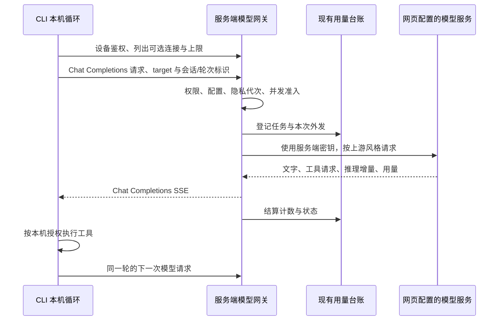

# CLI 服务端模型网关：设计

状态：Shape 已确认（2026-10-20），G-A 服务端实现覆盖见 §14；CLI 与 G-B 独立交付。对应 [brief](../comet/specs/cli-model-gateway/brief.md)、[spec](../comet/specs/cli-model-gateway/spec.md)，遵循[开发工作流](../development/development-workflow.md)。按用户已确认的 U1–U4 定稿：直接替换行为与接口、仅网关、可选 teaching／mentor、并发默认 10。

## 1. 现状与复用边界

以下入口已在当前工作树核对，后文标为“拟新增”的名称尚不存在。

| 现有位置 | 已有行为与本次衔接 |
| --- | --- |
| `clients/cli-go/internal/modelclient/core.go`、`packages/agentcore/modelclient/{client,stream,types}.go` | CLI 是共享 Chat Completions 客户端的别名封装，已有流式、推理展示、流式选项／非流式回退。注入 CLI HTTP transport 与宿主适配器，不修改共享请求／响应协议。 |
| `clients/cli-go/internal/command/agent.go` 的 `modelDependencies`、`agentDependencies` | 当前先读本地模型配置和钥匙串，完整 agent 还要求设备凭据。需整体换成设备鉴权的网关装配，涵盖启动、恢复、内部请求和连接测试。 |
| `clients/cli-go/internal/config/config.go`、`internal/modelsecret`、`internal/credentials`（后两者相对 `clients/cli-go`） | 删除本地模型连接字段、预设与 modelsecret；credentials 继续保存设备令牌。config 只保留客户端偏好、配对和网关选择／告知状态。 |
| `server/internal/settings/service.go` 的 `TeachingClient`、`MentorUsageClient`、`mentorClient`、`usageTransport`、`modelClient` | 已集中读取配置、持有密钥、固定配置指纹并装配调用。教学客户端在重启时冻结，导师按 MentorUsesTeaching 选槽；网关须按明确 target 读取当前 settings 连接，不复用导师的隐式选槽。 |
| `server/internal/settings/network.go` 的 `modelTransport`、`rejectRedirect` | 复用服务端精确端点允许列表、禁重定向和不继承环境代理的策略；不是把外部 URL 交给通用反代。 |
| `server/internal/integrations/llm/{client,responses}.go` | 已有 Chat Completions／Responses 路径、结构化请求和 usage 解析，但 `Chat` 使用 `stream:false`，尚无通用工具流转换。`settings.Service.validate` 也只允许 teaching 槽位选 Responses。 |
| `server/internal/mentorrun/core.go` 的 `budgetTransport.RoundTrip` | 名称仍带 budget，实际还承担身份、隐私、目的地与台账门禁；不能整段删除或直接绑定一个虚构 mentor run 来复用。 |
| `server/internal/modelusage/{store,transport,observe,query}.go` | 已有 `BeginTx`／`Dispatch`／`Observe`／`Finish`／`RecoverTx`；`Transport` 对同步外发记账，导师 transport 自行记账。一个上游出口只能装配其中一层。 |
| `server/internal/mentorrun/worker.go` 的 `claim` | 当前按有效 run 租约限制并发，事务 advisory lock 为 `210021`。同步模型出口尚无统一的同池准入；网关不能只另建进程内 semaphore。 |
| `server/internal/transport/httpapi/model_usage.go` | 已有汇总、任务和调用查询，但查询参数尚无 source／actor_device_id，Task DTO 也未展示设备。不能把“表里已有字段”写成筛选已完成。 |
| `server/migrations/000041_model_usage.sql` 至 `000048_studio_conversation_scope.sql` | 台账已具有 source／actor_device_id、可空 Token 和调用状态；设计基线最新序号为 000048，G-A 服务端新增 000049，见 §14。 |

选择“现有模型配置工厂 + 服务端协议适配 + CLI 网关适配器”。另建供应商客户端会重复安全和记账逻辑；直接给 CLI 配置与密钥会破坏已确认边界，均不采用。仅新增网关应用编排，不建设另一套模型设置、密钥存储或用量系统。

## 2. 架构和数据所有权



- identity 拥有设备、令牌和 scope；settings 拥有模型配置、密钥和共享上限。
- learning privacy owner 拥有台账，以及新增的 CLI 轮次归属、请求去重和运行租约元数据；接入现有 `learning_typed_payload` 清除及残留检查。
- CLI 拥有会话正文、本机工具结果、工具审批和执行恢复。服务端没有 CLI conversation/message 表，不创建导师 run 保存这些内容。
- 一次网关调用仅在内存中持有转发所需正文；请求结束即释放。跨请求仅保留计数与标识，不保留完整请求、回答、工具参数、推理正文或可重放的内容缓存。

## 3. 公共 API 合同

以下均为拟新增合同。协议版本 `1`；只接受已配对服务端的 HTTPS（本机开发沿用已有显式 HTTP 例外），设备令牌放 `Authorization: Bearer …`，不放 URL。CLI 拒绝跳转，不能将令牌或正文转发给另一 origin。除首次读取配置外，网关请求均携带协议版本与隐私代次 header；状态／取消也不能跨代次操作旧请求。

### 3.1 配置与能力

`GET /v1/model-gateway/config`：有效设备身份即可读取最小安全投影，不要求 `settings:*`；调用权限在 `invoke_allowed` 单独说明。Web cookie 不能用于模型网关请求。此 GET 不调用供应商，不产生模型用量。

```json
{
  "protocol_version": 1,
  "invoke_allowed": true,
  "available": true,
  "unavailable_reason": null,
  "privacy_generation": 7,
  "models": [
    {
      "target": "teaching",
      "display_name": "教学模型",
      "model_name": "configured-teaching-model",
      "configuration_revision": "opaque-config-revision",
      "destination_revision": "opaque-destination-revision",
      "context_tokens": 32768,
      "output_tokens": 2048
    }
  ],
  "limits": {
    "max_tool_steps": null,
    "idle_timeout_seconds": 60,
    "request_timeout_seconds": 900
  },
  "capabilities": {"stream": true, "tools": true, "reasoning_deltas": true},
  "admission": {"concurrency": 10, "per_device": 1, "cli_capacity": 9, "queue": false}
}
```

`models` 仅枚举 `settings.Target` 的 `teaching`、`mentor`，分别标为“教学模型”“AI 助手模型”，过滤未配置或未启用的连接，排除 search。不使用任意模型名作为连接标识，也不把 `EffectiveMentor` 当第三个候选。CLI 选择 mentor 指向该连接本身；网页 `MentorUsesTeaching` 不改变 CLI 已选 target，想使用教学连接时选择 teaching。

每项仅含名称／显示信息、有效窗口／输出上限及 target、版本等控制元数据；不返回 endpoint、密钥、允许列表或内部配置指纹。上下文和输出上限由所选连接工厂按当前 `Limits.ContextTokens`／`OutputTokens` 解析，两个连接的对应上限目前可相同，CLI 不自行推断上游容量。使用当前保存并通过校验的 settings 配置，不使用启动时冻结的 TeachingClient，也不覆盖网页原有重启语义。当前 mentor 仅允许 Chat Completions；网关支持它与 teaching 已可配置的 Responses，不顺带扩展网页导师的协议能力。

`configuration_revision` 是每个 target 的不透明版本，绑定连接、密钥与有效限制；`destination_revision` 是仅随 provider／endpoint／model／APIStyle 改变的不透明标识，用于目的地确认，不能反推出地址或秘密。其他连接改变不触发当前连接确认。密钥轮换只刷新配置，模型或目的地改变才要求再次确认；详见 §9。

`null` 工具上限代表不限；reasoning_deltas 仅表示可转发上游实际提供的增量。`available:false` 的原因是 `no_selectable_model` 或 `gateway_capacity_disabled`；调用权限由 invoke_allowed 单列。空列表提示在网页配置并启用模型，繁忙是即时请求结果，不缓存为配置不可用。本 GET 不做付费探测。

### 3.2 模型请求

`POST /v1/model-gateway/chat/completions`，需 `model:invoke`。共享客户端的 Base URL 为 `/v1/model-gateway`，仍由它追加 `/chat/completions`。

CLI 宿主适配器补充必填 header，不向 agentcore 请求结构增加字段：

| Header | 含义 |
| --- | --- |
| `X-Model-Gateway-Version: 1` | 明确协议版本；未知版本不外发。 |
| `X-Model-Configuration` | 所选 target 上次读取的 configuration_revision。 |
| `X-Learning-Generation` | 配置读取时的隐私代次，防旧轮次跨清除重放。 |
| `X-CLI-Session-ID` | 随机 UUID，本机会话的用量关联，不是网页会话 ID。 |
| `X-CLI-Turn-ID` | 随机 UUID，一次用户输入开始的新轮次；继续沿用。 |
| `X-CLI-Request-ID` | 随机 UUID，一次逻辑模型请求的去重身份。 |
| `X-CLI-Model-Stage` | 白名单 `foreground`／`context_observer`／`context_reflector`／`tool_limit_summary`／`session_title`／`probe`，不得接受自由文本。 |
| `X-Learning-Space-ID`（可选） | 沿用学习区 header；校验权限并固定本轮归属，不接受任意正文中的 space_id。 |

```json
{
  "model": "teaching",
  "messages": [{"role": "user", "content": "请检查这个文件"}],
  "tools": [{"type": "function", "function": {
    "name": "read_file", "description": "读取本机文件",
    "parameters": {"type": "object", "properties": {"path": {"type": "string"}}}
  }}],
  "max_tokens": 2048,
  "reasoning_effort": "auto",
  "stream": true,
  "stream_options": {"include_usage": true}
}
```

服务端明确校验现有共享客户端能产生的字段。messages 为文本及 function tool calls/results；不接收多模态、供应商托管工具、任意 headers、URL、API key、`previous_response_id`、`store` 或任意其他代理参数。`model` 字段承载 target，仅接受配置列表中的 `teaching` 或 `mentor`，不是上游模型名；服务端按 target 解析真实模型，改写外发请求。这样无需修改 agentcore 的请求结构。`max_tokens` 缺省取服务端值，有值时须为正且不超过服务端上限，不能静默扩大；请求文本、工具定义和输出预留合计不能已知超窗。

建议请求体上限 16 MiB，先在有界内存中完整校验再外发，超过返回 413。与共享核心复用上下文估算规则和安全余量，不将估算当实际 usage；供应商拒绝上下文仍如实报错。流式帧、工具参数及最终回答沿用共享客户端边界，不能靠网关扩大本机协议接受范围。

`stream:false` 返回普通 Chat Completions `choices[0].message`、`finish_reason` 及已知 usage。成功响应头含 `X-CLI-Request-ID`、`X-Model-Usage-Task-ID`、`X-Model-Gateway-Version`，不含上游敏感 header。

所选 target 的配置版本不匹配在外发前返回 409；禁用或删除后返回 503 model_unavailable。CLI 刷新列表，选择失效时停止并让用户重新选择；仅 limits 改变可重算上下文并提交确定尚未外发的请求。destination_revision 改变先告知并等待确认；密钥轮换只刷新。进行中的请求使用冻结配置，下一次请求重新比较，不在一条流中途换模型。禁用连接阻止后续新调用；立即中止活跃流的承诺适用于设备撤销和隐私清除。

### 3.3 状态与取消

- `GET /v1/model-gateway/requests/{request_id}`：仅原设备、当前代次、具备 `model:invoke` 可读；不存在、其他设备或已清除返回同样的 404。返回 `{request_id, task_id, state, dispatched, usage, reason}`，不返回正文。state 为 `accepted`／`running`／`succeeded`／`failed`／`cancelled`／`outcome_unknown`；usage 沿用可空 Token 口径。请求中发生多个上游尝试时返回已知合计、未知次数，不伪装单次完整值。
- `POST /v1/model-gateway/requests/{request_id}/cancel`：相同权限，空 JSON 请求体；返回 200 `{request_id,state:"cancelled"}`。对终态幂等返回已有终态；取消先于请求到达时可登记原设备范围内的取消标记，后到 POST 不得外发。此标记没有 task/call，不计调用。
- 取消先在权威状态中禁止继续，再通知运行实例关闭上游连接。GET 是核对入口，不是续流入口；不提供响应重放或 `Last-Event-ID` 恢复。
- CLI Ctrl-C 首先取消本地 HTTP context；能联网时补发一次幂等 cancel。断线后可查询状态；查询不到或上游结果未知时不把它解释为“没有消耗”。

### 3.4 SSE 与错误

成功流采用 `Content-Type: text/event-stream`、`Cache-Control: no-store`、`X-Accel-Buffering: no`。不引入要求 agentcore 认识的自定义成功事件；chunk 使用单个 `choices[0]`，index 为 0。

| SSE 帧 | 内容与完成规则 |
| --- | --- |
| `data: {"choices":[{"index":0,"delta":{"role":"assistant"}}]}` | 一次角色起始。 |
| `data: {"choices":[{"index":0,"delta":{"content":"…"}}]}` | UTF-8 文字增量。 |
| `data: {"choices":[{"index":0,"delta":{"tool_calls":[…]}}]}` | 以稳定 index／id 归并 function.name 和 arguments 增量；不提前执行半条调用。 |
| `data: {"choices":[{"index":0,"delta":{"reasoning_content":"…"}}]}` | 上游允许展示的推理／推理摘要增量，仅用于实时展示。 |
| `data: {"choices":[{"index":0,"delta":{},"finish_reason":"stop"}]}` | 工具轮次用 `tool_calls`；输出截断用 `length`，过滤用 `content_filter`，不能改成成功。 |
| `data: {"choices":[],"usage":{…}}` | 使用 Chat Completions 字段；缺失字段省略／null，不填假零。推理字段为 `completion_tokens_details.reasoning_tokens`，缓存字段按可对应的语义转发。 |
| `data: [DONE]` | 仅在正常上游结束、finish_reason 已处理后发送；usage 未报告可以完成。 |
| `: keepalive` | 15 秒一次注释，不能作为模型进展或重置服务端上游空闲计时。 |
| `event: error` + `data: {"error":{"type":"gateway_error","code":"…","message":"…"}}` | HTTP 头已发后的失败，随后关闭，不追加成功 `[DONE]`。 |

错误前的部分文字可以保留展示，但不提交为完整 assistant 回合，不执行部分 tool calls。响应写出使用有界缓冲和背压；单次写出超过 5 秒即取消，不为慢客户端无限积压。

未发流头时返回 HTTP 状态及同形 `error` envelope；额外关联使用响应头和状态查询。CLI 网关适配器识别稳定错误码并转换为友好提示；不依赖共享核心解析新的错误字段。错误 message 来自服务端固定模板，不能透出上游原始错误正文、端点和凭据。

| HTTP | code | CLI 文案／动作；是否可能外发 |
| --- | --- | --- |
| 400／413 | `invalid_request`／`request_too_large` | 请求无法发送／内容太大，调整后重试；未外发。 |
| 401 | `device_unauthorized` | 设备已失效，请重新配对；未受理的新请求不外发。 |
| 403 | `model_scope_required` | 请重新配对此 CLI；不外发。 |
| 403 | `model_not_allowed` | 请使用网页设置的模型；不外发。 |
| 409 | `configuration_changed`／`privacy_generation_changed` | 设置或数据状态已改变，刷新并按规则确认；不外发旧请求。 |
| 409 | `request_already_accepted` | 此次请求已受理，请核对状态；不再次外发，也不重放正文。 |
| 409 | `turn_binding_conflict` | 此轮归属已变化，开始新轮次；不外发。 |
| 422 | `context_limit_exceeded`／`output_limit_exceeded` | 内容或输出设置超过模型限制；本地校验失败不外发，上游拒绝已外发则保留调用记录。 |
| 429 | `gateway_busy` | 模型服务繁忙，请稍后重试；`Retry-After: 2`，不排队、不自动循环重试。 |
| 426 | `gateway_version_unsupported` | 请升级 CLI 或服务端；不外发。 |
| 503 | `model_unavailable`／`gateway_capacity_disabled` | 所选模型不可用，请重新选择／将总并发数调至至少 2；不外发。 |
| 503 | `gateway_unavailable` | 服务暂不可用，请稍后重试；根据请求状态核对是否外发。 |
| 502 | `upstream_error`／`upstream_incompatible`／`upstream_rate_limited` | 模型服务失败／不支持此请求／暂时限流；已尝试外发，保留记录。 |
| 504 | `model_idle_timeout`／`model_request_timeout` | 模型长时间没有回应／本次请求超时；可能已消耗，用户决定重试。 |
| 流内 | `device_revoked`／`request_cancelled` | 设备已撤销／已停止；停止输出并关闭连接。 |

有能力返回时附请求标识；网络断开时只能保留本地关联标识。不要把代理产生的 HTML 404／502 解析成成功 JSON，路径或协议版本错误提示服务连接不可用并检查部署，不把它当模型回答。

## 4. 上游协议适配与可靠性

在 `server/internal/settings` 提取按 target 读取连接、允许列表、秘密、transport 和配置指纹装配，供原调用与拟新增 gateway factory 使用；在 `server/internal/integrations/llm` 补通用 Chat／Responses 工具及流转换。`modelusage` 观察器放在**真实上游 HTTP transport**，按真实 APIStyle 解析用量，再转换成下游 Chat 格式。不能在已转成 Chat 的下游流上再计一次。

| CLI Chat 语义 | Responses 转换 |
| --- | --- |
| system／user／assistant 文本消息 | 对应 input 消息，保持角色和顺序。 |
| assistant.tool_calls | `function_call` input 项，保留 call_id、name、arguments；与同条 assistant 的文本按原顺序展开。 |
| role=tool、tool_call_id | `function_call_output`，call_id 必须匹配前面的调用；不从 arguments 推断工具权限。 |
| function 工具 schema | Responses function 定义；沿用已有 schema 适配，不丢 required／参数含义，不启用服务器托管工具。 |
| max_tokens、reasoning_effort | 映射 `max_output_tokens` 和上游支持的 reasoning 配置；明确指定且不支持时报告不支持该参数，不能静默降为另一强度。 |
| 文字／工具事件 | 将 `response.output_text.delta`、function-call item 及 `response.function_call_arguments.delta` 转为稳定 Chat 增量；done 事件用于核对完整性，不能重复追加已发参数。 |
| 推理与终态 | 可展示的 reasoning summary 增量转为 reasoning_content；completed／incomplete／failed 分别映射成功、截断／过滤、错误，usage 从真实终态读取。 |

Responses 请求显式 `store:false`，不使用 previous_response_id；每次只使用 CLI 传来的必要历史。只承诺文本及 function 工具的无状态协议子集；要求供应商托管会话、隐藏推理续接项或不受支持内容类型才能工作的模型明确返回 `upstream_incompatible`，不保存服务端会话或丢关键项后报告成功。原网页导师并不会因此自动获得所有 Responses 能力；本 change 只要求网关这条生产路径完成转换。

现有 agentcore `Usage` 中部分字段是整数且不含推理计数，不能用于构造完整服务端统计。网关 transport/CLI 宿主侧捕获原始 usage 的可空指标，用于界面展示；不完整 usage 不交给本机估算校准当作完整真实值。完整字段仍按既有协议交给 agentcore，推理和未知标识在外围展示，不给 agentcore 增加协议字段。

网关始终支持下游 stream_options 和非流式请求，不能把上游“不支持流式选项”错误原样暴露，诱使 CLI 再提交一个付费尝试。上游回退由服务端统一掌握：仅明确拒绝 stream_options 时最多去掉该项重试一次；明确不支持流式时最多再降为非流式一次，并以一个合法的下游流交付。每次新外发有独立 attempt。超时、断线、429／5xx、任何已发内容或不能证明被拒绝的错误均不自动重试，不自动切换供应商。

默认上游空闲超时取 `Limits.IdleTimeoutSeconds`（当前默认 60 秒，设置范围 5–600 秒）。服务端分别监测首个上游进展和后续进展，keepalive 不续命。另设每次请求最长 15 分钟的运行超时，作为部署参数下发，不是累计额度；CLI 的网关连接等待至少覆盖下发空闲值加 5 秒及整体期限，不套用普通 API 的 30 秒总超时。

无断点续流、后台重放或持久正文队列。断线、进程崩溃和超时后，仅恢复元数据与用量状态；用户重试使用新 request_id，同轮 task 不变，提示可能再次消耗。若已经执行过工具，重试从本机已提交结果继续，不能重放工具副作用。

## 5. 鉴权、配对、撤销和取消

新增 scope `model:invoke`，只允许模型请求和原设备请求的状态／取消，不包含 `settings:write`、模型密钥读取、通用学习审批或设备管理。`model:probe`、`settings:probe` 不能替代它。

- 新增 `cli` 配对 profile，权限为现有 user profile 的权限加 `model:invoke`；CLI 配对入口使用它，配对页面说明本地内容外发和用量归属。其他用途的 profile 不获得模型权限。
- Web session 的权限投影排除 `model:invoke`，不能用浏览器 Cookie 绕过设备 Bearer 通道。有效设备可读安全配置；没有模型权限时提示重新配对 CLI，不提供设备模型授权开关。
- 当前 `identity.Service.RevokeDevice` 只更新数据库，尚不足以取消活跃流。Build 把设备撤销和隐私清除接入运行取消注册表与跨实例通知；数据库是权威，通知用于及时关闭资源。

撤销的线性化点为权威事务提交：

1. 准入、每次真正外发和每次向 CLI 提交输出前，校验设备／令牌仍有效及 scope，并与撤销操作使用同一设备门禁锁。外发开始和输出提交使用短临界区；撤销取得排他门禁后禁止任何新提交。
2. 流的读取和完整生命周期不持有设备锁。输出写入临界区受 5 秒写超时限制，不能让慢客户端无限阻塞撤销；撤销成功响应只在事务与门禁生效后返回。
3. 撤销提交后广播取消，所有持有该设备请求的实例立即关闭上游和下游；失去通知连接时停止相关请求并重新核验，不靠长 TTL 缓存继续输出。周期复核只清理资源，不替代每次输出的权威门禁。
4. 撤销前已经交给网络的字节可能稍后到达；供应商可能已经计算或计费。承诺“不再开始新外发、不再提交后续输出、请求取消”，不能承诺供应商瞬间停算或追回已到达 CLI 的内容。

取消一个请求采用同样的请求状态门禁；正常取消不撤销整个设备。尚未外发的 call 结算 `not_dispatched`；明确取消已发调用记 `cancelled`，用量缺失仍为未知；无法确认调用结果的网络故障记 `outcome_unknown`。结算只写计数，允许使用现有有界的脱离请求 context 的收尾路径；隐私代次已改变则拒绝写回。

## 6. 用量粒度、幂等与状态

### 6.1 任务归集

- **session**：CLI 本机会话随机 ID，关联元数据不上传标题、工作目录或摘要；自动标题生成所需上下文属于仅内存转发的模型正文。恢复已有本机会话复用该 ID；转到另一服务端或设备产生新的用量归属。
- **turn/task**：一次用户输入产生 turn_id。task 的 kind 为拟新增 `cli_gateway`；origin_id 由服务端按 generation、认证 device_id、session_id、turn_id 派生稳定 UUID。使用现有 `(privacy_generation,kind,origin_id)` 唯一约束。
- **request**：一次 Complete／Stream，包括内部 observer／reflector、自动标题以及上限后的总结，产生 request_id；同轮共用 task。模型连接检查使用独立随机 session／turn，stage=probe，不混入对话。
- **call/attempt**：一次真实上游 HTTP 尝试一条 call；工具执行本身不记 call。服务端协议回退创建不同 attempt_key。用户重试创建新 request_id 和 attempt，保留相同 task。
- “继续”仍属于原 turn/task，工具次数重置；新文本输入创建新 turn。一个 session 可以含多个学习区的独立轮次，但一轮一旦受理不能改 space_id。无学习区归全局；客户端传入学习区必须由服务端校验权限。

任务来源固定 `cli`，actor_device_id 固定认证设备。每条 call 记录实际解析出的 provider／model／APIStyle 和服务端目的地标识，不将 teaching／mentor 当模型名；target 另作连接归属。同一 task 切换连接后各 call 仍按实际模型统计。不能只用客户端 UUID 作为全局 origin，否则不同设备能碰撞归属。来源／设备记录无需重建已有台账结构。

### 6.2 写入顺序

1. 验证协议、设备、配置、generation、正文大小／协议和学习区权限；申请并发名额。失败不外发，不计模型调用。
2. 同一准入事务内登记 request 去重身份、轮次关联和运行租约，调用 `modelusage.Store.BeginTx` 登记本次 attempt（`prepared`）。`task_id` 与轮次关联在同一事务完成，不能留下有归属但属另一设备的 task。
3. 外发前再次通过请求、设备和 privacy 门禁，调用 `Dispatch`，再由 `Observe` 包装真实上游 RoundTrip。失败时只结算该 attempt。实际传输已经开始却丢回执时不得恢复为未外发。
4. 原始协议观察器收集可空 usage，正常完成／错误／Close 时使用 `Finish` 幂等结算；更新 request 的生命周期，释放容量。请求成功与 call 的 `received` 不等价：收到合法 HTTP／用量但回答不合法时，request 仍可 failed。
5. 租约恢复使用 `RecoverTx`，prepared → not_dispatched，已发未结算 → outcome_unknown；不重发 HTTP 请求，不通过“补统计”调用供应商。迟到的真实 usage 只补原 call 的未知计数，不重复插入。

复用 `modelusage.Transport` 的观察、状态及隐私设施，但网关需将请求唯一身份／准入与 `BeginTx` 组合在同一事务；提取已有门禁钩子或在网关调用现有 Store 方法。不能同时叠加完整 `Transport` 和另一层 Begin/Dispatch。保留导师现有来源、知识、目的地等门禁，不能为复用而删掉。

### 6.3 请求状态与重试

| 当前情况 | 持久结果 | 后续同 request_id |
| --- | --- | --- |
| 尚未准入，校验失败或容量满 | 不登记已受理调用；提前 cancel 可有取消标记 | 更正／稍后重试仍须重新校验，不重复计数。 |
| accepted／running | 已受理身份、租约、attempt 关联 | 409，查询状态，不开第二条上游连接。 |
| succeeded／failed／cancelled | 仅保存终态与计数，不保存回答 | 409，不重放回答；用户决定是否以新 ID 请求。 |
| 已发后连接丢失或进程退出 | outcome_unknown，已知用量可保留 | 409，不通过自动重试猜测结果。 |
| 清除或 generation 改变 | 原元数据清除；旧代次输入不可用 | 409／查询 404，不能刷新代次后自动重发旧正文。 |

去重不要求保存提示词 hash：一个已受理 ID 的任何再次 POST 都拒绝，不需要比较正文。终态去重记录随台账保留到隐私清除，不设置短 TTL 后允许旧 ID 再次付费；不存在“把正文存下来以便恢复”的隐藏依赖。

### 6.4 查询与页面

扩展既有 `/v1/learning/usage`、`/tasks`、`/tasks/{taskID}/calls`，增加可选 source（web／cli／server）、actor_device_id、cli_session_id 筛选，Task DTO 增加设备和可空 CLI 会话／轮次标识。会话筛选须同时给定设备；cursor 与所有筛选、身份范围和 generation 绑定。

继续使用 `learning:read`、学习区权限和 response ReadPermit。模型权限不授予全局用量读取；仅有 model:invoke 的设备仍可读取自己的网关请求状态。页面从现有获准设备列表显示名称，设备已撤销也可辨认历史归属；无法获准读取名称时显示受限设备标识，不另存一份可能含敏感信息的设备名称快照。现有 source=cli 的服务端任务与网关任务均可筛出，kind 区分，不重复并入两个总数。

## 7. 并发、公平与运行租约

不做网关等待队列。满额立即 `429 gateway_busy`，这样没有待发正文的持久化需求，CLI 取消也不会留下稍后意外执行的请求。

沿用 `Limits.Concurrency = C` 的同一个池；`DefaultLimits()` 的 Concurrency 从 2 直接改为 10，校验范围仍是 1–16。默认 CLI 容量为 9，不增加设置文件转换逻辑：

- 每台设备所有网关请求（含探测、总结和内部整理）并行上限 1；所有 CLI 活跃请求合计上限 `max(0,C-1)`，总活跃工作不得超过 C。
- C≥2 时至少一个名额只供网页／既有服务端任务使用，即便网页暂时空闲也不借给 CLI；C=1 时网关配置返回不可用，提示将并发数调至至少 2，不擅自修改用户设置。按 U4 执行。
- 既有 mentor run 保留“承领到退出持有一个名额”的语义，嵌套模型调用继承该名额；同步网页模型调用按调用持有名额。不能 run 计一次、同一 run 的 HTTP 又计一次。
- 网关每次请求结束即释放名额，本机执行工具期间不持有服务端名额。多个设备不会因一个无限工具循环长期持有同一个网关名额。

将现有 `claim` 的全局事务锁与计数提取为共享准入端口，同时供网关及没有父 run 的同步模型出口使用。既有 run 租约和新增外发租约在同一临界区求和；对同一设备计数也须事务串行化。进程本地 map 仅用于关闭连接，不作为配额真相；多实例验证必须覆盖双机同时准入。

拟定短租约 30 秒、每 10 秒续约；在租约失效前未续约就停止外发和输出。回收只结算状态、不重新请求。关闭传输并结算后释放槽位，不能因 CLI 提交 cancel 就在旧传输仍开放时允许同设备并发第二次。该池约束服务端控制的活跃工作，不能证明网络中断后供应商已停止计算。

降低 C 时不杀死已经合法运行的网页任务；暂停新准入直到满足新限制，并取消已超出新 CLI 容量的请求（先取消较晚受理者），说明设置改变。模型参数在单次请求内冻结，容量策略按当前设置生效。新增准入必须覆盖 teaching／probe 等没有 mentor run 的同步出口；`source_discovery` 自己的搜索资源限制继续存在，但不能替代模型池限制。

## 8. 隐私、日志和部署

网关 handler、HTTP middleware、错误报告与 trace 均禁正文捕获；不得记录请求／响应 dump、完整 URL query、Authorization、工具参数、模型原始错误或推理正文。仅允许受限请求标识、脱敏设备标识、阶段枚举、耗时、HTTP 状态、稳定错误码和计数。日志不承担用量台账，也不额外保存可还原完整会话关联的数据。

正文只在有界内存中出现，禁止写临时文件、持久消息队列、失败样本和诊断附件；调试模式也不例外。模型配置的秘密只进入上游授权头。网关与 Responses 的 store:false 只约束本系统请求行为，不保证第三方日志政策。

沿用 privacy ReadPermit／response commit gate，让清除既能停止内存转发，也能禁止旧代次统计写回。新增表加入 `server/internal/learning/postgresstore/privacy.go` 的清除顺序和残留检查；设备撤销保留历史计数，隐私清除才按既有规则删除关联。并发租约回收、设备撤销、用量读取都不能绕过 owner gate。

`deploy/web/nginx.conf` 目前只放行特定路径。Build 必须同步增加精确匹配：

```text
/v1/model-gateway/config
/v1/model-gateway/chat/completions
/v1/model-gateway/requests/{UUID}
/v1/model-gateway/requests/{UUID}/cancel
```

对模型 POST 使用 `client_max_body_size 16m`、`proxy_request_buffering off`、`proxy_http_version 1.1`、`proxy_buffering off`、`proxy_cache off`、`proxy_max_temp_file_size 0`、`proxy_next_upstream off`；禁止 nginx 对 POST 的失败重发。上传须及时流向应用并受有界读取／上传超时约束，不能因 request buffering 落 client body 临时文件。应用读完校验前不发上游。

流式路径 `proxy_read_timeout 75s` 配合 15 秒心跳；这不是模型总时限，Go 单独执行空闲和 15 分钟请求期限。非流式响应没有心跳，代理超时须覆盖 15 分钟加收尾余量（建议 910s），或使用同路径 910s 并由 Go 心跳／写出超时保护流；采用后者以避免 nginx 按 body.stream 分流。状态、配置、取消使用短请求超时。该路径访问日志不记录 body、token 或 query；禁用缓存、压缩引起的长时间流缓冲。

不能用通配 `/v1/` 开放未知 API。配对与设备撤销仍使用既有入口，不顺带公开管理面。Candidate 经过实际 nginx 检查首帧、心跳、取消、请求上传无临时正文和错误无重发。

## 9. CLI 仅网关

### 9.1 命令、选择与首次运行

- `edu-agent model list` 拟新增：读取安全配置，列出可选连接及有效上限。`model show` 改为显示所选连接、模型名称、上限和用量归属；配置刷新不调用模型。
- `edu-agent model select teaching|mentor` 拟新增：只接受当前列表中的 target。TUI“设置 > AI 助手与模型”使用同一列表；不允许填写模型名、地址或密钥。没有选择时，唯一候选可在首次告知确认后选定；多个候选由用户选择，非交互命令提示先运行 model select；没有候选则提示到网页配置并启用模型。
- 删除 `model preset`、`model key` 和 model set 中的 provider／base-url／model／context-window／max-tokens／timeout／max-tool-rounds 参数；model set 仅保留上下文压缩、推理强度、会话历史等客户端偏好。TUI 删除提供商、地址、任意模型名、密钥和本地容量表单，首次向导改为“配对 → 选择模型 → 隐私告知”。
- `model test` 改为测试当前所选服务端连接，遵守配对、告知和用量规则；用户明确执行才外发。不能读取本地模型密钥或创建另一种模型客户端。
- 运行中切换连接先停止当前请求和待发的内部请求；选择只影响后续调用。刷新后向用户显示连接及模型名，实际发送前落实首次告知或目的地变更确认，不自动重试失败请求或重做工具。

### 9.2 本地状态与配置变化

直接调整 `config.Config`／`AgentConfig`：删除 provider 预设、BaseURL、Model、ContextWindow、MaxTokens、模型 Timeout 和 MaxToolRounds 及对应默认值／验证；删除 `internal/modelsecret` 的模型密钥读写与装配。普通 API 超时、配对配置、离线学习绑定和客户端偏好保留。

网关选择与告知状态直接存入受保护、原子写入的 config，绑定 server URL 和 device ID，保存 selected_target、已确认的 destination_revision、告知版本及服务端绑定。不建模式切换文件，不持久化上游 endpoint、模型密钥或用于离线运行的 limits；上下文、输出和工具上限在线读取。模型名称仅供显示，不能变成另一套连接配置。设备令牌仍由 credentials 保存，并仅送往配对服务端；本机会话、离线学习所用的加密密钥设施不属于 modelsecret，不删除。

每轮、明确“继续”及连接测试前刷新列表和配置；各模型请求携带所选 target 的配置版本，防止刷新后的竞态。只改变限制则重算上下文；模型／发送目的地改变则显示“所选模型服务已更改，继续会把相关对话发送给更改后的服务”，确认前不外发。密钥轮换不展示密钥，也不要求用户重新输入。所选连接被禁用、删除或配置不完整时保留所选标识并标为不可用，提示重新选择，不自动选列表中的其他项。

告知使用 brief 中的文案，保存确认版本，同一服务端不逐次询问；切换另一服务端或告知范围变化重新告知。解绑清除绑定的模型选择和告知状态。选择变更及会话恢复都不能触发自动发送。

### 9.3 未配对、服务不可用与独立命令

模型驱动的 agent 在未配对时提示配对，服务端不可用时提示稍后重试并停止本轮；不存在离线调用模型或单独驱动本机工具的新增入口。已经执行的本机操作按原恢复规则保留，不因重新联网自动重跑。

源码确认以下独立操作不依赖模型，保留原条件与行为：

| 入口 | 原行为 |
| --- | --- |
| command/app.go 的 version、help、config 查看 | 本地信息与设置查看，不要求模型连接。 |
| command/offline.go 的 `runOfflineLearn`、`runOfflineStatus`、discard | 已准备的学习包展示、作答、排队和本地状态管理；依赖既有学习包与设备绑定，不调用模型。prepare／sync 仍按原规则需要服务端。 |
| command/agent.go 的 `runAgentSessions` | sessions delete／clear 操作本机加密存储，依赖本地服务端绑定来定位档案，不要求模型可用。 |

没有发现脱离 agent 的独立文件读写或 PTY 交互命令；command/local_execution.go 等是 agent 参数装配，不能据此新增离线工具模式。

### 9.4 会话装配与内部模型调用

command/agent.go 的启动和恢复都改为消费网关有效配置。`agentcontroller.Dependencies.Provider`、`ProviderEndpointIdentity`、Start／Resume／ConfirmProvider、picker／switch 与 agentsession 当前保存的 ProviderName／ProviderEndpoint／ProviderModel 需要一起改为服务端绑定、target、目的地版本及显示信息；不伪造上游 endpoint 来满足现有结构。

恢复按当前绑定核对权限、目的地确认和已执行副作用；同一绑定复用 session 关联，设备／服务器改变建立新的用量关联。只有用户随后输入或“继续”才发送必要历史；正文与执行恢复数据仍留本机。`--no-save` 和本机会话加密行为保留。

除前台请求外，`agentloop/context_observer.go`、`context_reflector.go` 及 `agentcontroller.Controller.generateTitle` 都使用同一所选连接。网关适配器串行调度本设备请求：必要整理先完成，非必要后台整理和标题可延后或取消，等待仅在本机内存中且可取消。每个任务捕获触发时不可变的 session／turn／target／stage，避免记到下一轮或改选后的连接。内部输出预留不得超过下发上限；自动标题只存本机，服务端仅记录其模型用量。

## 10. 共享工具上限与预算清理

按用途区分累计额度与单次容量，不按 budget 字样批量删除。

| 现有位置／字段 | 处理 |
| --- | --- |
| `packages/agentcore/context_types.go` 的 ContextBudgetInvalid、`context_projection.go` 的 ContextPlanner.Plan | 保留窗口、输出预留、安全余量和历史投影；这是单次上下文容量。 |
| `packages/agentcore/agentlimits/limits.go` 的 MaxOutputTokens／ValidMaxTokens | 保留共享入口；CLI 有效值来自服务端，不再来自本地模型配置。 |
| `packages/agentcore/runner.go` 的 RoundBudget.take | 每次模型循环扣一次，语义不同于工具次数；CLI 不再用有限 MaxToolRounds 作门禁，由宿主计实际工具调用。agentcore 的协议及未被 CLI 使用的代码保持原样。 |
| `clients/cli-go/internal/agentloop/{execution,session}.go` 的 MaxToolRounds／remaining | 移除 CLI 的重复模型轮数限制，改为工具计数和可继续状态；普通交互和审批等待不重置。 |
| `clients/cli-go/internal/command/workbench_study.go` | 删除 request_budget／token_budget 输入、requests_left／tokens_left 余额及增额表单；工具上限暂停使用 paused_tool_steps 和 resume，retry_start 仅保留无增额的失败重试语义。 |
| `server/internal/mentorrun/{types,command,query,compat}.go`、`transport/httpapi/mentor_runs.go`（后者相对 server/internal） | 删除预算字段、余额投影、paused_budget 分支和 continue_budget；删除预算请求解码的特殊处理，使用现有 resume。同步对应 DTO、OpenAPI、CLI 与网页调用点，不保留重复字段或动作入口。 |
| `server/internal/settings/types.go` 的 ResearchRequests／ResearchTokens | 删除不再控制执行的累计预算字段、默认值、验证及有关投影；保留输出、窗口、超时、并发、存储限制。 |
| 本机文件／artifact／复制／查询内存、工具参数与结果大小限制 | 保留单次 I/O、内存、存储与权限边界。 |

CLI 本地未发现另一套累计 Token／请求余额扣减器；主要是残留表单、接口投影和模型轮数门禁。前台、整理、标题及进展说明请求都经网关统计，不用极大预算替代删除。

工具上限取 `Limits.MaxToolSteps`（null 不限），每轮开始及明确“继续”读取并固定到本轮结束；中途修改在下一轮或继续时生效。无法读取则提示重试，不以缓存启动新一轮。已经开始的一轮可使用其内存中的上限，但服务不可用后停止模型循环；不建立离线工具上限缓存。

每个实际执行的工具请求计一次；一次回复含三个 tool_calls 计三次，失败但已经执行也计数，等待批准未执行不计。到限保留未执行部分、收回工具，再经网关发一次无 tools 的进展说明，随后暂停。说明失败仍暂停并显示已有进展；“继续”重新计数，不重跑已完成调用。observer／reflector 的结构化整理及自动标题不交给业务工具执行器，不扣工具次数，但模型外发照常记账。沿用 `pauseForToolSteps` 的可观察语义，不复用其持久导师状态实现；不限时不增加隐藏固定总步数。

## 11. 数据库变更与文件边界

下一数据库 migration 暂名 `server/migrations/000049_cli_model_gateway.sql`（拟新增），Build 起点核对序号；本次不创建。source／actor_device_id 已存在，不重复加列。

| 拟新增元数据 | 最小字段与约束 |
| --- | --- |
| `learning_cli_model_turns` | generation、actor_device_id、session_id、turn_id、可空 space_id、task_id；同代次设备／session／turn 唯一，task 唯一且 generation 一致；真正受理时关联。 |
| `learning_cli_model_requests` | generation、actor_device_id、request_id、可空 turn/task 关联、target、配置版本、状态、取消原因枚举、创建／结束时间、lease_id／lease_until；同代次设备／request 唯一。先到取消标记可无 turn/task/target，不计模型调用。 |
| `learning_model_execution_leases` | owner、source、device、请求或父 run 关联及有效期；已有 run 继续用原租约计数，不能再占第二份名额。 |

schema 仅保存标识、版本、计数和状态，不保存正文 hash、请求／响应 JSON、密钥或原始端点。call 复用现有 model、lease、attempt 字段；新增表和用量表同属 learning owner，加入隐私清除和残留检查，回收也经过 privacy gate。

### 11.1 CLI 文件边界与直连移除

下表路径除注明外均相对 `clients/cli-go/`；既有文件已核对，新增项明确标记。

| 模块／文件 | Build 变更 | 批次 |
| --- | --- | --- |
| `internal/config/config.go` | 删除模型连接字段、DefaultAgentConfig 预设、APIKeyOptional 与相关验证；保存网关选择／告知及客户端偏好，保留设备与离线学习绑定。 | G-A |
| `internal/modelsecret/{store,system}.go`、`store_test.go` | 删除模型密钥模块及其专属测试；移除调用点。credentials、keybackend 与会话加密继续服务设备和本机数据。 | G-A |
| `internal/command/app.go` | 删除 ModelSecretStore／ModelSecrets、dashboardModelKeySource；替换 NewModel 工厂签名和装配，dashboardSnapshot 从网关投影取模型状态。 | G-A |
| `internal/command/agent.go` | 重写 runModel、runModelSet、modelDependencies、agentDependencies、agentTimeouts；删除 saveDashboardAgentKey／providerName；改启动、恢复与显示，连接测试走网关。 | G-A |
| `internal/command/device.go`、`client_config.go` | CLI 配对使用 cli profile，解绑清理模型选择／告知，保持普通设备配置和凭据规则。 | G-A |
| `internal/dashboard/dashboard.go` | 删除提供商／地址／密钥表单和 TakeModelKey；首次向导、设置、快照与帮助改为服务端连接选择；保留客户端偏好页面。 | G-A |
| `internal/modelclient/core.go`；拟新增 `internal/modelgateway/` | 保留共享 Chat 客户端封装；新增安全配置投影、设备 transport、请求标识／取消／错误映射和本设备串行调度，不再装配供应商直连。 | G-A |
| `internal/agentcontroller/{controller,picker,switch}.go` | 更换 Provider 装配及会话目的地确认；generateTitle 捕获轮次、连接与用量上下文，受网关上限和串行规则约束。 | G-A |
| `internal/agentsession/{types,store}.go`、`internal/agentui/{agentui,session_picker}.go` | 更新模型绑定元数据及恢复确认／显示；保留本机加密、检查点和工具恢复，不新增正文同步。 | G-A |
| `internal/agentloop/{context_observer,context_reflector}.go` | 内部整理使用同一网关模型、有效窗口和输出预留，携带触发轮次。 | G-A |
| `internal/agentloop/{execution,session}.go` | G-A 停用本地有限轮数门禁；G-B 实现共享 MaxToolSteps、逐工具计数、进展说明和继续。 | G-A／G-B |
| `internal/command/workbench_study.go` | 去预算表单、余额及增额动作，接入无预算接口与 paused_tool_steps／resume。 | G-B |
| `internal/command/{agent,agent_session,agent_learning_integration,model_settings,large_context,app}_test.go`、`internal/config/*_test.go`、`internal/dashboard/{dashboard,model_settings,large_context}_test.go` | 替换本地预设、模型密钥 fake、NewModel 签名及直连 httptest 夹具；连接类场景改为设备配置＋网关＋上游，纯工具测试保留模型 fake。 | G-A |
| `internal/agentcontroller/*_test.go`、`internal/agentsession/*_test.go`、相关 agentloop／workbench 测试 | 更新绑定和有效上限夹具；验证内部请求归属、标题并发、恢复不重发、工具计数及预算残留删除。 | G-A／G-B |
| `README.md` 与 command 内帮助文本 | 更新配对、模型选择、连接测试、故障提示；不再介绍本机模型设置。 | 随所属批次 |

`packages/agentcore` 不在修改边界；CLI 宿主需要的元数据、限制和调度在外围实现。不因 CLI 不再使用某些模型构造或轮数入口而删除共享代码。不修改与模型无关的 offline／localexec／workspace 行为。

### 11.2 服务端与网页边界

- **identity／httpapi**：`server/internal/identity/{domain,service}.go` 的 profile、scope 和 RevokeDevice，网关设备鉴权及撤销；不新增设备授权管理 API。
- **settings／llm**：`server/internal/settings/{types,service,network}.go`、`server/internal/integrations/llm/{client,responses}.go`；按 target 提取装配、直接改默认并发、实现两种上游工具流转换。预算残留字段在 G-B 删除。
- **网关／用量／隐私**：拟新增 `server/internal/modelgateway/`；复用 `server/internal/modelusage/{store,transport,observe,query}.go`、`server/internal/mentorrun/worker.go` 的 claim 和 `server/internal/learning/postgresstore/privacy.go`。按实际模型计量，补同池准入、来源／设备／会话查询及清除顺序。
- **接口／装配／部署**：`server/internal/transport/httpapi/model_usage.go`、`server/internal/app/`、`server/api/openapi.yaml`、`deploy/web/nginx.conf`；新增网关配置／请求／状态／取消及用量筛选。G-B 同步删除预算 DTO 与动作残留。
- **页面与预算调用点**：`clients/web/src/{usage-page.tsx,api/usage.ts}` 展示来源、设备与模型筛选；G-B 同步 §10 所列服务端入口及相应网页、CLI 调用点。只清理本次预算合同相关代码，不泛化重构。

## 12. 拆分评估与垂直批次

保持单 change、27 条验收，新的 G-A／G-B 两批串行实施。原 G-A（网关）和原 G-B（Responses）合并为新 G-A：演示站上游为 Responses，移除直连必须与 Responses 支持同批交付，否则首批 CLI 无法在演示站完成主流程。模型选择也前置到 G-A，使配置列表、target 请求及装配一次收敛，不引入临时固定模型接口。原 G-C 剩余的工具上限和预算清理成为新 G-B，不再保留 G-C 编号。

scope、配置版本、去重、计量及共享容量服务同一请求链，按协议或客户端拆 child 会共享公共文件并留下不可运行入口。若 Build 发现必须另建独立会话同步或供应商托管状态子系统，返回 Shape，不纳入本 change。

### G-A：仅网关，两个上游协议均可运行

- **结果**：配对并完成告知后，用户可选择教学／AI 助手连接，在 CLI 使用 Chat Completions 或 Responses、执行本机工具，并按设备及实际模型核对用量。
- **范围**：网关配置、POST、状态、取消；cli profile／撤销、隐私、去重、默认并发 10 和共享准入、必要 migration；Chat／Responses 完整工具流与用量适配；模型选择、首次向导、全部直连配置／密钥／装配移除；内部整理和自动标题、会话恢复绑定；用量查询／页面、OpenAPI、nginx。
- **延期**：共享的有限工具次数、进展说明／继续和累计预算残留清理交 G-B。首批不再使用本地有限 MaxToolRounds，默认不限可运行，但不宣称已完成有限 MaxToolSteps 或整个 #122。
- **退出标准**：真实 CLI → HTTP handler → 两种协议假上游 → PostgreSQL 台账完成文字与工具两次调用；teaching／mentor 选择、失效、配置变化和记忆可验证，search／任意模型被拒绝；Responses 文字、多工具分片、UTF-8、推理摘要、非流式、完整／部分／缺失 usage 及截断场景通过。重复 ID、繁忙、撤销、断线和清除不重发、不泄漏；协议选项回退按每次真实 attempt 计数，流已开始不重试。自动标题和整理不并发占用本设备，不误记轮次。未配对／服务不可用无模型外发，已有独立命令正常；模型配置、密钥注入与直连测试夹具已移除或替换。受影响 Go package、相关数据库和 CLI 场景通过，文档／OpenAPI／帮助同步；可控 nginx smoke 证明流首帧和取消。
- **重型证据**：实际演示站 nginx、多实例故障注入和完整跨平台门禁在 Candidate 集中运行；首批用真实生产路径与可控上游验证两个协议。供应商实测仅在有密钥与费用授权的环境进行，未实测不得声称演示站已验证。

### G-B：共享工具上限与无累计预算

- **结果**：网页与 CLI 使用同一工具上限，默认不限；达到上限后用户能明确继续，两端不再要求累计预算。
- **范围**：逐工具计数、批准等待、进展说明与继续；本轮设置刷新及无缓存行为；workbench 预算表单、余额和服务端字段／动作残留清理，同步调用点、OpenAPI 与帮助。
- **延期**：无本 change 承诺留给后续批次；新增能力回 Shape。
- **退出标准**：上限 3 下验证多工具计数、未批准不扣次、失败但执行扣次、普通等待不重置、说明失败仍停住、继续不重复副作用；设置改动在下一轮／继续生效，无法读取不能以缓存运行。长轮次不因累计请求／Token 停止；单次输出、窗口和 I/O 边界仍生效。客户端到服务端不再传预算或依赖余额、增额动作；受影响 package 与相关接口场景通过，三份文档和最终接口／帮助一致。
- **重型证据**：跨平台设备凭据／会话恢复与完整 Runtime 门禁留 Candidate，复用同一候选输入的有效证据。

## 13. Ready、候选验证与主要风险

U1–U4 已于 2026-10-20 确认，无待决问题，满足 Ready。已确定结果／范围／非目标、27 条合同、单 change 理由、数据 owner、公共 API、数据库变更、文件边界、首批退出标准与重型环境。Shape 阶段工作区为 docs/shape-122，该阶段只改三份文档；Build 起点复核 migration 编号及依赖当前状态，不再以产品确认作为门禁。G-A 服务端实现记录见 §14。

Candidate 核对全部 27 条合同，集中验证真实 CLI 的两个上游协议；PostgreSQL 多实例去重／撤销／并发／隐私清除；模型选择、内部调用、工具继续、会话恢复及 nginx。正式演示环境的可用性须由 Candidate 实测，协议 fixture 不替代部署证据。verification 由 Runtime 生成，本次仅抽查路径、函数、链接与文档一致性，不宣称实现或测试通过。

主要风险：

1. **Responses 工具流转换**：已有实现主要为非流式教学请求；需完整处理分片、完成条件和未知 usage，不改变 agentcore 协议。
2. **撤销与共享并发的跨实例竞态**：门禁覆盖真实外发和每次输出提交，避免父 run／嵌套调用重复占位。
3. **直连依赖遗漏**：首次向导、会话恢复、自动标题、整理和测试工厂都依赖原本地配置；必须一起改为网关并保留非模型命令及本机副作用恢复。
4. **连接变更后的外发对象**：选择用稳定 target，配置版本与目的地确认分离；禁止禁用后自动换连接、更新后自动发送历史或重做工具。

## 14. G-A 服务端实现覆盖

本节记录 `feat/gateway-server` 工作树中的 G-A 服务端实现；CLI 由独立任务交付，未修改 `clients/cli-go` 或 `packages/agentcore`。G-B 的共享有限工具上限及预算残留清理不在本次实现范围。

| 模块 | 实际落点 |
| --- | --- |
| 身份 | `identity` 新增 `cli` profile（user scopes 加 `model:invoke`），WebScopes 显式排除该 scope；管理配对页说明本地内容外发与用量归属。网关仅接受设备 Bearer，拒绝 Web Cookie 和浏览器派生 token。 |
| 连接工厂 | `settings/connection.go` 的 `ModelConnection`、`FrozenConnection.Client` 按明确 target 读取当前连接；`connectionIdentity` 与既有用量 transport 共用。网关不使用冻结的启动教学配置或导师隐式选槽。配置／目的地版本使用 PostgreSQL 部署秘密计算 HMAC，跨实例和重启稳定；秘密不属于学习数据，也不下发。 |
| 协议 | `integrations/llm/gateway.go`、`gateway_stream.go` 验证文本/function 请求、复用 agentcore 的上下文估算与 5% 余量，转换 Chat／Responses 流与非流式。Responses 显式 `store:false`，保留工具 call_id、参数、结果关联；done 事件不重复追加参数或正文。仅在明确拒绝 stream_options／stream 时有限回退，其他错误和开始输出后不重试。 |
| 用量 | `modelgateway/store.go` 在同一事务中登记轮次、请求、租约及 `BeginTx`。`transport.go` 先提交 `Dispatch`，再在真实上游 transport 调用 `Observe`，按原始 APIStyle 观察。每次回退有单独 attempt；`Finish` 结算后释放槽位，再交付下游完成信号，使工具下一轮可立即开始。 |
| 准入 | `modeladmission.CheckTx` 复用 advisory lock `210021`，统计导师原租约与新增模型租约。`mentorrun.claim` 和同步 `modelusage.Transport` 接入同池；导师嵌套调用不重复占位。默认 C=10，CLI≤C−1，每设备≤1；新租约 30 秒、10 秒续约，无等待队列。降低容量时按受理顺序保留较早 CLI 请求，在续约时取消超额请求。 |
| 撤销和清除 | `000049_cli_model_gateway.sql` 的事务触发器通过 PostgreSQL LISTEN/NOTIFY 广播设备／token 撤销、请求取消和 learning 代次关闭。通知连接丢失即取消本实例活跃请求。准入、实际请求写出和每次响应写出仍核验权威设备、请求、租约和隐私门禁。清除 grant 的设备锁移至隐私 owner 门禁之后，修复与在途读取的锁顺序冲突。 |
| 恢复和隐私 | `Service.Sweep` 与状态查询调用 `RecoverTx`；prepared → not_dispatched，dispatching → outcome_unknown，不重发。新增三个 learning 元数据表加入 typed payload 清除和残留检查。仅持有有界内存正文，错误使用固定模板，HTTP 日志仅记录请求元数据。 |
| 用量查询和页面 | usage summary/tasks/calls 增加 `source`、`actor_device_id`、`cli_session_id`；会话筛选必须带设备，游标绑定所有筛选。Task 增加设备、会话和轮次标识。网页提供来源、设备、会话和既有模型筛选；设备名称来自获准的设备 API，撤销设备仍可辨认，无法读取名称时显示受限标识。 |
| 装配和部署 | `httpapi.Options.ModelGateway` 注册四个精确接口；`app` 装配通知监听和周期恢复。OpenAPI 及网页生成类型同步；nginx 增加精确路径、16 MiB 上传限制、关闭请求／响应缓冲和失败重发、910 秒代理读取时限、禁用网关访问日志。 |

### 与 §3 的接口对齐说明

路径、必填 header、target、协议版本 1、配置字段、成功 JSON/SSE、错误 envelope、去重及取消语义均沿用 §3。以下补全了原文未展开的 JSON 细节，供 CLI 任务直接对齐：

- 请求状态的 `usage` 使用现有 `modelusage.Totals`：`calls`、`pending_calls`、`outcome_unknown_calls`，以及 `input`／`output`／`reasoning`／`total`，每项为 `{known_sum, unknown_calls}`。多个 attempts 一并汇总；这与模型响应本身的 Chat usage 字段不同，后者仍省略缺失字段。
- 状态／取消的 404 envelope 使用稳定 code `request_not_found`；§3 规定了 404 行为但未给该行命名。提前取消标记的 `task_id` 为 null、`dispatched` 为 false、usage 中 calls 为 0。
- `length`／`content_filter` 保留原 finish_reason，不伪造完整回答；持久请求状态为 failed，已发生调用和已知计数照常保留。
- 正常完成的请求在最后输出前已结算并释放上游名额；最后输出仍经过设备和隐私门禁。状态说明服务端已知的上游结果，不表示客户端一定收到了全部网络字节。

### 验证范围

使用 `TEST_DATABASE_URL` 指定的真实 PostgreSQL、隔离 schema、`httptest` 假上游和正式 HTTP router 验证。共享 `agentcore/modelclient` 作为消费者完成两种上游的“工具请求 → 工具结果 → 最终回答”，同轮两次调用累计为一项任务；未改动共享协议。

自动测试覆盖：文字／多工具分片、工具 ID／名称／参数分片、UTF-8、推理摘要、完整／部分／缺失 usage、较大 Responses 终态计量、截断、非流式、有限回退 attempts、重复 ID、提前取消、设备串行、网页保留名额、同步教学出口同池、双服务实例通知、撤销／断线／隐私清除关闭流、迟到用量拒绝、恢复不重发、search／任意模型拒绝、正文不进入数据库或 HTTP 日志，以及来源／设备／会话查询。

检查结果（2026-10-20）：先 `umask 022`，受影响 Go 包的 `go test -p=1` 和 `go vet -p=1` 均通过；mentorrun 使用 `-timeout 40m`，整包复验耗时 1085.858 秒。llm 与 modelgateway 另通过包级 `-race` 检查。网页 `npm run generate` 和 `npm run check` 通过；未运行全项目测试或三浏览器矩阵。

当前环境没有 nginx 可执行文件，因此这里只完成部署配置编辑与人工核对，未声称通过实际 nginx smoke。真实 CLI 二进制联调、实际部署代理、独立进程故障注入和真实供应商验证留给并行 CLI 任务及 Candidate；假上游不代表演示站或供应商验证。

## 15. G-A CLI 实现覆盖

本节记录 `feat/gateway-cli` 的 CLI 实现边界；服务端、agentcore、OpenAPI 与部署由独立任务交付，不能以 CLI 假网关测试代替服务端或部署验收。

| 落点 | CLI 行为与验证 |
| --- | --- |
| `internal/modelgateway` | GET 安全配置、Chat Completions 适配器、Authorization 设备鉴权、禁止跳转、§3.2 请求头与随机 request ID。模型体的 model 为 target，共享客户端 Base URL 为 `<server>/v1/model-gateway`。假网关验证文字／工具两次调用、错误不重发、HTML 404／502、流内错误、重定向、取消和串行。 |
| `internal/config`、`command/model_gateway.go` | 保存 server/device 绑定的 selected_target、destination_revision、notice_version；只保留客户端偏好，无本地连接／容量／模型秘密。list/select/show/test 使用在线配置，选择失效保持原选择并停止；配置版本变化刷新，目的地变化须确认。首次告知使用 brief 原文，确认前连配置 GET 也不发出；非交互入口提示先在终端确认。解绑清除选择与告知。 |
| `internal/dashboard` | 从相同安全配置投影显示 teaching／mentor，不提供供应商、地址、任意模型名或密钥表单；保留压缩、推理及历史偏好。为遵守本任务“确认前无任何请求”，告知确认在在线列表读取之前。 |
| `internal/agentcontroller`、`agentsession` | 将 Provider 元数据替换为网关 server/device/target/destination/model 显示信息，另持久化随机 gateway_session_id。同一绑定恢复复用该 ID；拒绝设备变更不改写原归属，确认改变绑定后生成新 ID。恢复不发模型请求、不重做工具。 |
| `internal/agentloop`、自动标题 | 每次用户输入前刷新配置并采用在线窗口／输出上限；标题、observer、reflector 捕获触发轮次及连接，使用明确 stage，内部输出不超过所选上限。每个 server/device 在本进程共用可取消调度器；新轮次取消旧内部任务。工具审批／问询的继续沿用该轮快照和 turn ID。 |
| 超时、错误与用量 | 流式空闲等待为下发值 +5 秒，整次期限采用 request_timeout_seconds；非流式遵循整体期限，不套用普通 API 30 秒总超时。Ctrl-C 取消 HTTP context 后，在 5 秒收尾期限内补发一次 cancel；失败请求保留 request ID。稳定错误映射为中文，不展示服务端原始错误正文。部分 usage 不交给共享核心当完整计量校准。 |
| 直连移除与独立命令 | 删除 modelsecret 包、preset/key 命令、本地连接字段及密钥注入。HTTP 模型测试夹具改为假网关；纯工具测试保留模型 fake。设备凭据、本机加密、离线学习和本机会话删除保留。 |

与服务端对齐的接口假设：

- 协议版本为 1，privacy_generation 为 JSON 整数；target 仅 teaching／mentor。配置刷新携带已知协议和隐私代次；代次冲突停止本次操作，下一次用户主动操作重新读取代次。配置响应保留 limits，包括不可用时的安全投影；版本标识为不透明字符串，不含凭据。
- 成功 SSE 使用 §3.4 的标准 Chat 帧和 `[DONE]`；流内错误使用 `event: error` 与同形 error envelope。上游兼容回退由服务端完成，CLI 不根据上游错误重新提交。
- cancel 使用 `POST /v1/model-gateway/requests/{request_id}/cancel`、空 JSON `{}`，带原请求的版本和隐私代次；不自动重试取消，也不自动重发正文。
- 现有配对兑换合同仍只有 `code/display_name`；`cli` profile 由网页／服务端生成配对码时确定。CLI 配对入口明确提示使用 cli 配对码，网关以 invoke_allowed 判定模型权限；CLI 不向兑换请求添加未约定字段。

本次任务明确将 MaxToolRounds、共享 MaxToolSteps 和累计预算清理留给 G-B，因此保留已有 MaxToolRounds 偏好及执行行为；这覆盖了本任务的范围约束，区别于 §11.1／§12 原先拟定的首批停用安排。现有问询／工具审批恢复沿用本轮归属；新的共享工具上限“继续”入口在 G-B 实现时须调用相同的配置刷新及轮次绑定逻辑。

验证使用 `httptest` 假网关，不使用供应商密钥或付费调用。受影响包的 race／vet 以及 CLI 模块全量测试结果由本次实现报告列出；真实服务端、nginx、PostgreSQL、多实例和跨平台验收仍由对应任务／Candidate 承担。

本工作树检查结果：`internal/config`、`modelgateway`、`command`、`dashboard`、`agentloop`、`agentcontroller`、`agentsession`、`agentui` 的 `go test -race`、`go vet` 均通过；最终 `go test ./...` 通过。Go 构建缓存使用 `/tmp/ga-cli-go-build`，未改动系统配置。`git diff --check` 通过；`server/`、`packages/agentcore` 和暂存区均无改动。
