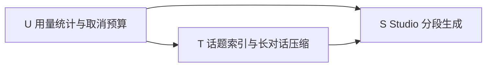

# 对话、Studio 与用量：Shape 拆分与交付顺序

状态：Shape 待审（2026-10-18）。本次只交付文档，尚未达到进入 Build 的用户审阅条件。

调查基线：`docs/shape-117-118`，基于 main `8bf53f2`；最新 migration 为 `000040_study_exercises.sql`。已读取 [#117](https://github.com/ErzerLP/edu-agent/issues/117)、[#118](https://github.com/ErzerLP/edu-agent/issues/118) 正文及 2026-10-18“用户已确认的决定”评论。确认评论和本次任务的决定摘要优先于 issue 初稿；例如不再按轮次显式切段、不再设置任务预算。

## 1. Supervisor 与三个 child

按[开发工作流](../development/development-workflow.md)拆分：以下三个结果能分别演示和验收，且涉及不同的数据和状态。合成一个 change 会把用量、对话索引和多阶段内容生成混为一个候选。此文档作为 Supervisor 的协调设计，不复制三个 child 的验收条款，不创建 Runtime 状态或 verification 文件。

| 顺序 | capability | 用户结果 | 文档 |
| --- | --- | --- | --- |
| U | `model-usage` | 查看用量，任务不再因次数或 Token 预算暂停 | [brief](../comet/specs/model-usage/brief.md)、[spec](../comet/specs/model-usage/spec.md)、[设计](model-usage.md) |
| T | `conversation-topics`，#117 | 长对话可继续，按话题回看相关消息 | [brief](../comet/specs/conversation-topics/brief.md)、[spec](../comet/specs/conversation-topics/spec.md)、[设计](conversation-topics.md) |
| S | `studio-staged-generation`，#118 | 在 Studio 确认规划，逐段生成并恢复，整理选定话题 | [brief](../comet/specs/studio-staged-generation/brief.md)、[spec](../comet/specs/studio-staged-generation/spec.md)、[设计](studio-staged-generation.md) |

依赖是公共契约依赖，不要求提前实现后续能力。U 首先交付能使用的统计页和至少一条完整模型调用路径，再覆盖服务端其他调用并取消预算；T 使用统一调用台账，产出话题范围与受限来源读取契约；S 使用两者。共享 settings、HTTP 路由、migration、app composition 和隐私 owner 修改按此顺序串行，不能以并行 child 同时修改同一 schema。各 child 内采用垂直批次，详见各设计。

U 独立完成不代表超长上下文已解决：T 接入前旧对话仍有历史大小限制，S 接入前旧 Studio 仍可能一次装载过多来源。Supervisor 只有 T/S 也验收后，才可宣称长对话与大量来源不再因累计内容超过窗口失败。

## 2. 已确认边界

- 只取消任务累计请求次数和 Token 上限；保留 `output_tokens`、`context_tokens`、外发授权、并发、存储、超时、资料范围与输入格式边界。不能把累计调用次数换一个名字重新作为预算。
- 话题索引是对话的只读派生资料，不是掌握度。学习状态摘要来自 Attempt → Assessment → Evidence 等已有学习事实，跨同一区的对话汇总；两者不能互相冒充。
- 常规 Studio 输入是所选来源、学习方向、学习状态摘要和可选侧重点；“整理本次对话”额外接受用户选定的话题投影。Studio 两种入口都不读取原始对话。issue 初稿的“最近几轮原文”改由 #117 的增量整理消化后提供话题投影，遵从本次“不读原始对话”的边界。
- 来源是内容事实的唯一依据。摘要只决定关注什么，不能成为引用或使未选来源重新外发。练习提示在模型数据中写“以正式记录为准”；用户界面写“练习结果以学习记录为准”，不暴露后台术语。
- 不改 CLI 行为，不改 `packages/agentcore` 协议；服务端可以增加适配层。#111 只衔接现有章节树、确切版本、页码和覆盖缺口，不在本次实现整本书导入。

## 3. 所有权与共享契约

| 数据／契约 | 负责模块 | 消费方与约束 |
| --- | --- | --- |
| 模型调用台账 | 拟新增服务端 `modelusage`，纳入 learning privacy owner | 所有服务端模型出口；只存数字和受保护的关联，不存 prompt、回答、隐藏推理、密钥 |
| 对话原文、消息锚点、话题与覆盖水位 | `mentorrun`，learning owner | UI、上下文组装、Studio 话题范围；索引不回写原文 |
| 有界学习状态投影 | learning 事实查询，S 中增加读取适配 | 同一区所有获授权记录；无有效 Evidence 不宣布掌握；不从对话口头结论补齐 |
| 来源目录与片段 | `knowledge` 及 postgres store，knowledge owner | T/S 共用 manifest 限定的目录和片段读取；禁止退回全集合检索 |
| Studio job、规划修订、分段候选 | 应用编排在 `mentorrun`，内容持久化在 `learningcontent`，learning owner | worker 使用现有租约；只有内容 owner 校验成功才保存／发布 |
| 测验作答与评估 | `learningstart`、`learningcontent`、learning | 沿用每题一个会话、操作回执和旧题资料版本 |

所有派生数据同时记录 learner privacy generation 及实际依赖的 knowledge／memory generation。失效检查覆盖读取、外发前、提交前和响应发送，不只检查创建时。清除涉及任务、派生正文、锚点、操作载荷、用量关联和聚合；迟到响应不能恢复旧数据。

## 4. Migration 与兼容顺序

下面是草案文件名，**本次不创建 SQL**。编号以 Build 合入时最新迁移重新分配，不承诺预占编号。

1. `000041_model_usage.sql`：调用台账、索引与清除登记；旧预算字段先保留为兼容输入，停止消费其值。
2. `000042_conversation_topics.sql`：消息锚点映射、话题、证据锚点和整理水位；旧原文密文不整体改写。
3. `000043_studio_jobs.sql`：job、规划修订、分段及操作回执；扩展产物 body schema 的读取能力，保留旧版本。

上述三批均须同步各 owner 的 scrub／verify、密钥轮换和响应代次门禁。若垂直批次需要附加迁移，新增后续文件，不修改已发布 migration。旧数据不凭空补 Token，不自动启动旧任务；旧 `paused_budget` 只通过用户动作恢复。API 兼容及请求哈希版本方案见 U/S 设计。

旧 notebook Shape 中关于每次请求预算、预算用尽恢复的要求由 U 替代；Studio 一次生成由 S 替代。来源权限、记录权威性、产物版本、每题会话等原合同继续有效。本次不改写旧文档的历史实施记录。

## 5. Ready、退出与返回 Shape

当前结论：拆分、owner、公共接口草案和首批退出标准已明确；五个产品问题仍待审，建议默认值见各 brief 末尾。它们不是已确认决定，相关 child 在用户确认前不进入 Build。U1 影响统计范围；T1 影响旧对话整理时机；S1–S3 影响修改记录、题型和部分结果的可用性。

进入每个 child 的 Build 前，还须确认前置 child 提供的公共契约已经稳定、migration 编号已重新核对、当前工作树归属清楚。Build 每次只推进一个垂直批次；批次成功不等于 Candidate／Archive。Candidate 再运行完整相关验证，verification 仅由 Runtime 生成。

以下变化返回 Shape：开始采集 CLI 本地调用、改变统计或摘要保留范围、把话题判断变成成绩、自动扩大来源、跳过规划确认、增加题型或改变部分测验可作答规则、取消隐私或外发门禁。比例调优、索引选择、租约实现和不改用户合同的局部重构保留在 Build。

## 6. 本次验证范围

只核对文档链接、代表性路径与函数，检查文档差异；不运行测试、生成 OpenAPI、创建 migration 或改业务代码。各设计中的验证清单是未来 Build／Candidate 的退出要求，不是本次已通过的证据。
