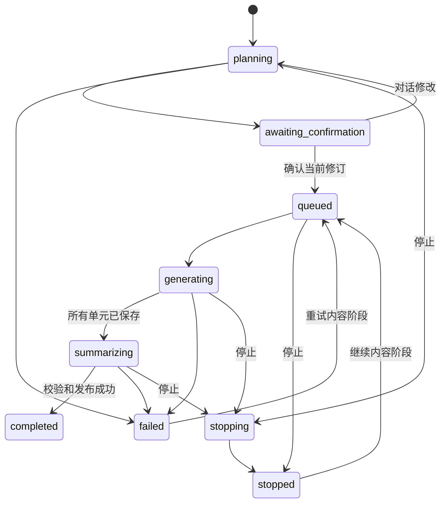

# Studio 规划与分段生成：设计

状态：Shape 已确认（2026-10-18）。对应 [brief](../comet/specs/studio-staged-generation/brief.md)、[spec](../comet/specs/studio-staged-generation/spec.md)。前置为 [U 用量台账](model-usage.md)和 [T 话题及受限来源读取](conversation-topics.md)。S1–S3 已确认采用建议默认值，前置契约稳定后进入相应 Build。

## 1. 现状与方案选择

已核对：`server/internal/mentorrun/studio.go` 的 `CreateStudio`、`StudioModelRequest`、`generateStudio` 以一次 run 完成产物；`selectedMaterial` 经 `sourceMaterialTx` 和 `knowledgepg.ReadSourceSelectionTx` 读取所选文档全部片段。现有 `learningcontent.StudioSchema`／`DecodeStudioCandidate` 只支持 guide、brief、quiz，note 只通过 `StudioSave` 手工保存。生成笔记需要新增内容校验，不能仅打开前端按钮。

采用“持久生成 job + 规划修订 + 分段候选 + 最终产物版本”。继续让单个 run 的 checkpoint 保存全文会重新碰到大小上限；把每个片段立即发布为产物版本则会污染已保存列表，并使未完成测验与题目会话难以绑定，均不采用。job 是编排对象，mentor run 是一次可恢复执行载体，Studio artifact/version 仍是可使用内容的身份。

## 2. 输入快照与事实边界

| 输入 | 来源、范围和用途 |
| --- | --- |
| 来源 manifest | 只包含当前学习区勾选的确切 collection/document revision、hash、knowledge generation。所有内容事实和引用只来自它。 |
| 学习方向 | 受理时 direction revision；指南／简报／笔记只需方向文本，测验通过既有 managed goal 适配取得确切 goal revision，不给其他类型伪造教学目标。 |
| 学习状态 | 从同一区所有获授权的学习记录读取有界结构；不按当前对话限定，也不扫描聊天。只用于安排重点、难度和建议标签。 |
| 侧重点 | 用户可选文字及建议标签，作为数据而非系统指令；用户输入不能扩大来源或权限。 |
| 对话整理范围 | `conversation_id,topic_ids,index_revision,through_message`；由 T 返回安全话题投影，不返回原始 Messages。普通 Studio 无此输入。 |

学习状态建议由 learning 查询端口确定性提炼，首版不额外调用模型：`as_of_event_seq, direction_revision, recent_concepts, needs_review, help_used, mastered_evidence, pending_assessments, coverage`。每项含知识点身份、短标签、记录引用、发生时间和必要状态；总共最多 24 个知识点，错误／需帮助与近期记录优先，再补已掌握条目。可以遍历分页学习投影来选择，但送模只送有界结果；不是把前 24 条碰巧读到的记录当完整学习状态。

掌握只由有效 accepted Evidence 支持；提交但未评估的答案标记 pending，失效、待复核或旧方向记录不变成当前掌握。方向更新不抹掉历史。摘要不含作答全文、题干全文、聊天摘录或未选来源正文，记录事实与资料事实分区。与所选资料无关的学习点可提示无法覆盖，不能用状态摘要补出教材没有的事实。

状态为空时照常按来源生成；暂时不可读时显示“学习记录暂不可用，本次按资料生成”，不能伪造状态。建议标签依据同一状态投影形成，最多几个简短选项，不给用户展示 event ID 等内部身份。点击标签只是填入侧重点，不写回学习记录。

## 3. 目录规划、片段选择与窗口

复用 T 已建立的 manifest 限定目录／片段端口；不能用 `knowledge.Retrieve` 对全集合检索后再过滤，不能把整份 `SourceDetail` 的全部 Fragments 交给模型。现有无向量的 Markdown 标题树足以开始。

1. **目录准备**：读取所选文档的标题树和可用覆盖信息，带确切 node revision；目录很大时按层／页展开，先匹配方向、状态和侧重点，再读取相关子树。未知和未展开章节保留为未覆盖，不能根据标题补正文事实。
2. **规划**：指南／简报／笔记输出 section ID、主题、目标、章节引用和预期覆盖；测验输出 question plan ID、知识点、题型、难度和章节引用。模型只能选择给定目录身份，未知节点拒绝。规划不携带可供正式作答的题目或评分结果。
3. **确认前预检**：检查来源可读性与预计分段输入。过大的部分按真实子章节／原文范围形成有限子单元，展示总部分数与必要子进度；不能确认后任意扩大内容范围。没有章节点的长段落按行／段落范围切片，不虚构新章节。
4. **逐段读取**：每个单元只带其目录引用所需片段、方向／相关状态／侧重点、短规划和必要的前段衔接摘要。前段摘要只帮助连贯，不充当本段事实依据。引用使用 request-local 索引，服务端映射回稳定 manifest 身份。
5. **立即校验**：按确切源版本、node revision、range、文本和 hash 核验引用，保存校验后的结构化部分；不等最终汇总才校验。范围缺口作为 coverage 元数据，不要求模型为“未覆盖”伪造引用。
6. **汇总**：全部单元完成后，用一次简短调用读取有界段落摘要、允许复用的已核验 claim/citation ID 和未覆盖目录，产生总览／衔接／缺口。只可重述已支持的事实；不允许新取全文或扩展来源。不把完整产物重新塞进模型。

窗口计算使用 T 的 C/O/M/F 规则，规划／分段／修复／汇总分别估算，所有输入含 schema。超大规划上下文分页缩小，超大正文拆子单元；最终合并通过确定性程序完成，不再做一次全量模型请求。用户确认的大纲和有限片段决定步数，不用累计 Token／调用次数阈值代替预算，也不受 U 的“每轮工具调用上限”影响。

推理模型的 reasoning Token 计入输出。沿 `settings.StudioClient` 和 `integrations/llm` 的 API style 适配，在配置支持时通过 Responses native json_schema；普通 Chat Completions 仍需本地闭合结构校验，不假设有原生 schema。不能把 Responses 强塞进共享 agentcore。输出因长度截断而 JSON 不完整时不保存为成功：保留其他单元，允许缩小当前单元的内容粒度后重试，或说明需要调整单次输出配置，不自动提高 `output_tokens`。

每个相同输入候选允许一次有明确错误反馈的自动结构／引用修复；仍失败进入可重试状态，不无限调用。此为同一失败的恢复策略，非任务总次数上限；继续其他已确认单元不要求增加预算。Provider 明确拒绝窗口时重新校准当前单元并收缩输入，不能原样循环重试。

## 4. 数据模型与产物关系

下列表名和字段为拟新增。迁移草案 `000043_studio_jobs.sql`，Build 时重新编号；不修改 000035–000040 的历史文件。

| 数据 | 主要字段／约束 |
| --- | --- |
| `learning_studio_jobs` | `id,space_id,device_id,privacy_generation,version,status,kind,active_plan_revision,confirmed_plan_revision,usage_task_id,target_artifact_id,expected_artifact_version,created_at`；输入快照和关联范围放密文。 |
| `learning_studio_plans` | `(job_id,revision)` 唯一；规划密文、输入指纹、方向／来源／状态／话题快照身份、确认时间、schema version。每次修改追加修订，不覆盖已确认版本。 |
| `learning_studio_plan_messages` | 按已确认的 S1 保存已发送的修改文字、模型修改说明、operation 及顺序，全部加密；不保存未发送草稿。 |
| `learning_studio_units` | `(job_id,plan_revision,unit_id)` 唯一；顺序、父 section／question ID、输入指纹、状态、执行 run ID、attempt、结果密文及引用；只校验成功才有 committed result。 |
| `learning_studio_job_operations` | device、operation ID、请求哈希版本、job ID、回执；创建、修改、确认、停止／继续均可核对。 |
| `learning_studio_section_revisions` | `(artifact_id,version,section_id)` 唯一，保存发布后的不可变部分和引用；不能因删除生成 job 丢失已发布内容。 |

snapshot 密文包括来源 manifest、所选话题投影、学习状态和侧重点；AAD 绑定用途、space、job／revision、privacy generation。索引只存必要身份与状态，不把摘要、修改文字或来源目录名称放进可搜索明文列。

**mentor run 关系**：每个规划、修改、内容单元及汇总有独立 stage run，附同一个 job 和 U 根任务 ID；run 沿用租约、停止、事件和身份检查，checkpoint 只存本单元必要输入。新增 job/stage 关联区分新会话头，不复用当前按 device/space/goal 聚合的 legacy Studio session head。migration 中新增可空 `studio_job_id` 与相应唯一约束，使旧 session 唯一规则只约束 legacy 行；新 job 内每次同 stage/unit/attempt 最多一个有效 run。

**发布关系**：单元保存不创建 Studio artifact version。全部内容及汇总通过后，learningcontent 在同一事务内复核 manifest、目标 expected version、generation，创建一个产物 revision、部分关联、操作回执并将 job 标为 completed。`StudioPublishTx` 需要支持新的分段发布入口，仍由内容 owner 核验，不能由 worker 绕过。响应丢失后查询同一 operation 返回同一 artifact/version。

guide／brief／note 的新 body schema 2 存有界总览与不可变 section 目录，正文分页读取；避免最后又把所有部分塞入一个受 `MaxBody` 限制的 JSON。guide 保留概念／顺序／重点用途；brief 保留简洁总览与可展开依据，不把“简报”变成整本书。旧 schema 1 按原样读取，不迁移内容。

生成笔记新增有引用的结构化 note candidate，并提供可编辑 Markdown 投影。用户明确保存修改形成新版本；引用块仍须与原片段匹配，新增自写文字标为用户笔记，不冒充模型已核验主张。笔记转来源继续指定已保存版本、审阅后生成独立副本；分段笔记导入按顺序读取已发布部分，并保留既有导入体积限制和明确超限提示，不自动截断或绕过导入审阅。

schema 2 笔记按部分打开和编辑，每次保存以产物 expected version 创建新 revision，未修改部分引用已有不可变内容；不能把整份分段笔记拼回旧 `StudioSave` 的 64000 字节字段。旧 schema 1 笔记保留原整体编辑方式。两种方式都保持明确保存、冲突保留输入和旧版本可读。

## 5. 状态机和恢复

图中展示主要路径；恢复目标由 checkpoint 决定，规划失败／停止恢复到 planning，已有规划则回 awaiting_confirmation，汇总失败恢复到 summarizing，不一律重跑内容。来源撤权、隐私失效进入不可续跑的 invalidated，不拿新来源补位。每个 job 同时一个执行租约，首版逐段串行，避免多段争用保存顺序。

| 动作／竞争 | 规则 |
| --- | --- |
| 多标签编辑 | 必须带 expected job version 和 plan revision；CAS 冲突保留本地输入，不自动覆盖。模型修改受理后如果版本变化，输出不覆盖新规划。 |
| 删除／排序 | 在待确认规划追加修订；引用稳定 section ID，不按数组下标误删另一个部分。排序同时支持键盘“上移／下移”。 |
| 确认 | operation 绑定确切 plan revision 及输入指纹；规划未通过预检不能排队内容生成。重复确认返回原回执。 |
| 停止 | 串行化 job version，撤销活动执行租约并取消在途请求；停止提交后不能派发后续单元。已成功提交部分保留，迟到正文不再提交，已消费 Token 仍结算。 |
| 继续 | 查原 job，校验目标／来源／配置／generation，再从第一个未成功单元开始；成功单元不重跑。需要新目的地确认时沿既有授权交互，不能静默切换模型外发位置。 |
| 完成与停止同时到达 | 同一事务锁／CAS 决定先后；若完成先提交，停止返回已完成；若停止先提交，迟到 publish 被拒绝。 |
| 修改已确认规划 | 从原输入建立新的待确认修订，用户再次确认后启动新执行代；旧成功候选保留可查看但首版不自动跨修订复用，防止来源／顺序改变后错配。 |
| 发布版本冲突 | 保留 job 和已完成部分，提示目标内容已更新；通过明确“另存为新产物”或重新选择目标版本解决，不覆盖较新的笔记。 |
| 未知外部结果 | 不宣称 exactly-once 调用；检查原 stage 是否已提交，只有未提交才重试，新 attempt 新计数。业务发布和题目映射幂等。 |

按已确认的 S3，stopped／failed 下已完成部分可查看、可从已保存进度继续；全部规划内容及汇总完成后才发布产物并开放测验，不提前采用部分结果或开放部分测验。最终 `coverage=partial` 表示相对于所选资料还有未覆盖范围，**不等于执行只完成了 3/8**；已确认八部分全部完成仍可能 coverage partial。两种状态必须分开显示。

## 6. API 草案与面板

前缀沿用 `/v1/learning/studio`，全部需要学习区 Header 和既有权限／代次校验。草案在 Build 才写 OpenAPI。

| 方法与 suffix | 载荷／结果 |
| --- | --- |
| `POST /jobs` | `operation_id,privacy_generation,kind,source_selection,direction_version,focus?,conversation_scope?,artifact_id?,expected_version?`；创建输入快照并规划，返回 job ID、version 和 run 回执，不接受任务预算。 |
| `GET /jobs`、`GET /jobs/{id}` | 列表／快照、当前规划、真实进度、可执行动作、失败单元及用量链接；来源／状态正文按权限读取。 |
| `POST /jobs/{id}/plan-messages` | `operation_id,expected_version,plan_revision,text`；一次受限修改 run，返回修改后的新规划修订。只发当前规划、必要已发送修改摘要和本次文本，修改对话本身也不能无限增长。 |
| `PATCH /jobs/{id}/plan` | 同版本及 operation 字段，`delete_ids,ordered_ids`；原子直接修改，返回新 revision。 |
| `POST /jobs/{id}/confirm` | operation、expected version、plan revision；确认后预检结果和实际规划一致才排队。 |
| `POST /jobs/{id}/commands` | `stop,resume,retry,revise,save_as_new,delete`；绑定版本及 operation；`save_as_new` 仅解决已完成候选的发布冲突，不等同采用未完成部分。 |
| `GET /jobs/{id}/units`、`GET /jobs/{id}/events` | 分页已保存部分和顺序事件；断线后按序号继续或回读快照，不重复创建任务。 |
| `GET /artifacts/{id}/sections?version=…` | 新 schema 2 的分页内容；同一 version 返回同一已发布顺序和引用。 |
| `PUT /artifacts/{id}/sections/{sectionID}` | 仅 schema 2 笔记；operation、privacy generation、expected artifact version 及该部分的修改正文；显式保存为新的产物版本。 |

job 的来源、方向和状态快照在受理时固定。待确认前用户要求改变来源／方向，可明确刷新输入形成新规划；直接更改左栏勾选不会暗改 job。已确认后变更输入必须走 revise／新 job，不用 UI 当前选择覆盖持久快照。

Studio 面板为“规划／生成进度／结果”三个阶段。规划修改输入在本面板底部，删除、拖动与键盘排序操作同一 revision；移动端仍在 Studio 标签内，不切到导师输入。已发送修改按 S1 保存，未发送草稿只保留标签页内存，刷新前提示；创建 job 是明确保存任务的动作，不把仅打开面板当持久化授权。

## 7. 测验与对话整理

### 测验

按已确认的 S2，首版只做文字作答的开放题，分简答和解释两类，难度可选；默认 3 题、支持现有 1–8 题，沿用开放式文字回答内核。选择题、自动判分以后另做 Shape。每题规划含稳定 ID、知识点、难度、题型与源章节；用户修改“更难一点”更新规划，仍由确认开始。

逐题生成 prompt、rubric、allowed_help 和核验引用，均保存为单元。题目汇总只描述练习覆盖和建议顺序，不提前暴露答案或 rubric。全部完成后发布一个 quiz artifact/version；保留现有 quiz 可读形状和 question 顺序，生成过程本身不创建学习会话。

开始题目仍经 `learningcontent/studio_quiz_store.go` 和 `learningstart/studio_quiz.go`：以 `(artifact_id,version,question)` 绑定一个会话、活动和内容版本；继续使用单题内核、前题完成要求及原操作回执。Attempt → Assessment → Evidence、真实 help 下限和复核门禁不改。生成任务的 unit ID 与正式题号在发布时建立不可变映射；重新生成不会复用旧题的答案或活动。迁移 000037／000039／000040 的既有关系保留。

### 整理本次对话

入口在对话工具栏，类型只给“笔记／复习测验”，范围勾选 #117 的全部可用话题或子集。默认预选当前对话已有话题，用户可删选；摘要无权支持的来源不自动勾上。受理时将选定 topic IDs、index revision 与水位绑定，普通 Studio job 不因带 conversation ID 就读取其他聊天。

未整理尾部由 T 在原授权内先做增量整理；失败时保留旧可用话题，明确未覆盖最新内容，让用户选择先重试或使用当前已整理范围，不能静默宣称整理了全部对话。Studio 从 T 获取有界主题投影，**不读取原始消息，最近原文也不例外**。这是对 issue 初稿“摘要加最近原文”的收敛，以本次已确认输入边界为准。

所选话题只用于知识点与疑问范围，事实再次到当前所选来源中寻找；不足时展示缺口或要求补选资料。学习状态仍按区聚合用于难度建议，但不能把未选择话题扩成新的内容部分。最终仍回到 Studio 的规划视图，由用户确认。

## 8. 旧数据和旧 API

| 对象 | 兼容方案 |
| --- | --- |
| 已有 artifact/version | 原 schema 1 直接读取，引用和题目会话不改；不把旧产物拆分重写，不自动重新生成。 |
| 旧手工笔记 | `StudioSave` 保持原含义，新增生成笔记不把手工保存变成模型调用；原 note 编辑／转来源仍有效。 |
| 新 schema 2 产物 | 新 Web 用 section API；旧读取接口需显式协商支持的 body schema，未协商时对新格式返回可识别的 unsupported 提示及能力信息，不能返回空内容或伪造完整旧格式。旧 ID 的读取不变；不要求 CLI 更新来读取其已有内容。 |
| 旧 `POST /generations` | 保留 legacy 固定结构调用：guide／brief 用已有固定栏目，quiz 用原 3 题结构。旧显式生成动作只授权该固定结构，内部可按相关片段分步执行；不自动引入新动态大纲或新内容范围。最终仍返回旧 run 回执及可读 schema 1 结果。新 Web 不再调用此入口。 |
| 旧大输入生成 | 在旧固定栏目内受限取片段，必要时分子单元，明确 partial 覆盖；不发送全部全文，不因任务预算暂停。旧结果大小边界保留，不伪称全资料覆盖。 |
| `token_budget`／`request_budget` | 旧入口按 U 接受并忽略，新 job 无这些字段；严格类型、操作回执和载荷冲突规则不变。 |
| 已在运行／暂停的 legacy run | 按原保存状态恢复；升级不自动启动旧暂停，不把旧请求解释为新动态 job。存量不可继续的缺失 checkpoint 返回原明确错误，不编造新产物。 |

legacy 固定结构入口只是兼容既有行为，不拥有对话改大纲能力；新动态规划全部必须确认。CLI 源码和共享模型循环不变，旧操作哈希优先回放方案沿 U。新 API 的 operation hash 绑定输入快照、plan revision、命令及版本，不受模型重试随机性影响。

## 9. 隐私与生命周期

job、规划修改、学习状态投影、topic scope、unit、发布 section 归 learning owner；原始来源仍归 knowledge owner，学习事实仍由其原 owner 管理。新增密文接入 `learningcontent.RotateKeyTx`／app 组合，新增表接入 `learningcontent.RedactTx`、其计数校验以及 learning 的 typed-payload scrub／verify。

每次外发同时检查 identity、learning 及实际依赖的 knowledge gate／链接；学习状态不得以缓存绕过 tutoring／记录权限。返回正文、提交 unit、发布产物、创建单题会话时重新检查对应 generation。清除先取消租约和 read permit，再清掉派生数据与关系；旧回复不能保存为新代次。

删除 job 清除未发布候选、输入及修改对话；已发布产物独立存在，按既有删除／清除合同处理。T 中删除对话使仍依赖它的未完成整理 job 失效；已明确保存的产物作为独立结果保留，移除失效对话跳转，不从它重建摘要。隐私清除仍同时清掉这些结果。

来源失权时已存部分也要按来源阅读规则隐藏／标不可用，不把“曾经生成过”当作绕过撤权的理由。浏览器不持久缓存这些新正文，退出、撤权或 generation 变化清理页面状态与订阅，防止迟到事件恢复内容。

## 10. 垂直批次与退出标准

### S-A：在 Studio 修改并确认规划

- **结果**：用户依据所选资料、方向和学习状态生成指南／简报／笔记大纲，修改、删除、排序并确认；可重开恢复。
- **范围**：学习状态查询、目录预检、job／plan／修改记录、模型调用台账、API、面板、清除和轮换；确认先保存为待生成状态。
- **延期**：分段执行及发布留 S-B，测验与对话整理留后批。此批不得把待生成任务显示为完成产物。
- **退出标准**：真实后端入口能完成规划与多轮修改、版本冲突、删除排序、刷新恢复；无原始对话外发，目录超窗能分页，模型伪造章节被拒；相关 package／迁移／页面最小检查通过，更新协议文档。
- **重型证据**：跨浏览器与真实模型重点偏向抽查留候选，先用受控响应验证引用和 revision 行为。

### S-B：文档分段生成、停止继续与发布

- **结果**：指南／简报／笔记逐段保存，显示进度，停止后可继续，汇总成功后得到可打开的新版本。
- **范围**：unit 执行、schema 2 内容、引用验证、汇总、产物发布／编辑／转来源衔接、旧固定结构入口兼容。
- **延期**：题目规划与对话入口；采用部分结果按 S3 不提供。
- **退出标准**：总来源超窗及单章节超窗可生成；3/8 停止后刷新继续只处理剩余；无效引用不保存、汇总失败可单独重试；发布与停止竞争、旧 schema 读取及目标版本冲突有最小验证。相关 Go、数据库、HTTP／Web 检查和接口文档完成。
- **重型证据**：候选运行真实推理模型的结构输出／截断和大目录样本；本批不以桩证明真实模型质量。

### S-C：题目规划与原学习路径接通

- **结果**：用户修改题目规划，生成后逐题开始、提交并收到既有评估反馈。
- **范围**：quiz 规划／逐题单元／发布映射、`studio_quiz` 与单题内核衔接、题目面板及用量。
- **延期**：S2 以外题型、部分题目提前作答和对话整理入口。
- **退出标准**：单题一会话、旧题方向／来源版本、帮助下限、重复开始／提交和评估恢复均经相关最小检查；生成不会写 Attempt／Evidence；旧测验可继续，文档同步。
- **重型证据**：真实出题质量与端到端评估在候选抽查，不因新增规划重复全扫无关学习模块。

### S-D：按话题整理本次对话

- **结果**：用户在长对话勾选话题，进入 Studio 生成相关笔记或复习测验。
- **范围**：对话入口、T 的范围投影适配、尾部整理与缺口提示、job 输入快照和选题限制。
- **延期**：整本书导入和其他产物类型不纳入本入口。
- **退出标准**：部分话题选择无越界；最新尾部未覆盖能先整理或明确采用旧范围；无来源可操作提示；删除对话／清除时迟到 job 不能复活；相关浏览器和后端最小检查通过。
- **重型证据**：S Candidate 再核对全部 28 项，用真实模型抽查跨对话学习状态对重点的影响、长对话相关性、移动端和可访问性；Supervisor 核对 U/T/S 的统一统计、隐私与旧客户端契约。#111 仅用已有大目录 fixture 验证衔接，不要求导入实现。

## 11. S-A 实现覆盖

本批实现指南、简报、生成笔记的“生成大纲 → 多轮修改／删除／排序 → 确认 → 待生成”。`queued` 仅表示大纲已确认，不创建 artifact、内容版本、练习或学习证据。新 Web 将生成任务单列，旧产物和手工笔记继续使用原入口；测验仍使用旧固定结构入口，待 S-C 接入题目规划。

| 范围 | 实际落点与边界 |
| --- | --- |
| 持久化 | `000045_studio_jobs.sql` 创建 `learning_studio_jobs`、`learning_studio_plans`、`learning_studio_plan_messages`、`learning_studio_job_operations`。规划只追加修订，修改记录保存已发送文字及成功／失败说明；操作回执保存确切版本、修订和运行身份，不复制不断增长的修改正文。输入、规划、修改和回执分别加密，AAD 绑定用途、学习区、任务、隐私代次及修订／操作身份。 |
| 独立执行 | `mentorrun/studio_jobs.go` 为每个任务建立独立 Studio session，每次规划／修改建立 stage run，沿用原 worker 租约、checkpoint、身份和代次检查。新 `studio_job_id` 不参加旧 session 的唯一绑定；旧查询和插入仍只匹配 legacy 行。任务永久状态独立于七日运行载体，已保存大纲和修改不因运行过期而丢失。 |
| 学习状态 | `learning/postgresstore.ReadStudioLearningStateTx` 从同学习区正式 Attempt、Assessment／Decision、有效 Evidence、实际帮助记录读取明确的元数据列，不读取题干、答案或原始对话。先对全区知识点排序和计数，再选择最多 **24 个**；错误／需帮助优先，其次近期记录，再补历史证据。类别可以共享知识点，短标签最多 **48 字符**，建议最多 **4 条**；返回事件水位、总数、纳入数和 coverage。掌握沿用 `ReduceNode` 的 retained 判定，pending、失效和旧方向不变成当前掌握。 |
| 状态不可用 | 查询保留 **2 秒**局部超时，明确的查询取消或锁争用通过 savepoint 回滚，仅将状态标为 `unavailable`；界面提示“学习记录暂不可用，本次按资料生成”。权限、隐私、格式和数据库结构错误继续失败，不用空摘要绕过授权。 |
| 来源与目录 | 创建时冻结 manifest、方向 revision、状态和侧重点；只读取方向文本，不为指南／简报／笔记创建 managed goal。目录由 T 的 `ReadSourceDirectoryTx` 每页最多 **64** 条遍历，按方向、状态、侧重点及本次修改排序保留至多 **48** 个候选，再按包含 schema、输出及安全余量的窗口估算缩小。正文不进入规划请求；未纳入章节数量及尚未核验正文的提示随规划保存。 |
| 模型协议 | 模型返回 title、coverage、sections、uncovered、explanation。section 包含稳定 id、topic、objective 和本次 directory 的章节序号；本地闭合解码、去重和范围校验后，映射为真实 node revision 与原文范围，未知章节拒绝。最多 **24 部分**、每部分 **8 章**；根据配置固定不超过 **4096 字节**的预计切片粒度，显示预计小段数。正式逐段读取和引用验证留 S-B。 |
| 多轮修改 | 只发送当前规划、最近 **3 条**有界修改背景（每条文字最多 1200 字节、说明最多 800 字节）及本次完整修改（最多 4000 字节）。不进入导师对话，不创建 Attempt／Assessment。结构或章节无效时最多一次带明确错误反馈的修复，仍失败则保留上次大纲及失败记录，由用户重试。 |
| 并发与确认 | 修改必须带 `expected_version`、`plan_revision`、`operation_id`；删除与排序原子执行，并以稳定 section ID 寻址。CAS 冲突不覆盖当前规划。确认核对规划输入指纹并重新分页检查确切目录身份和范围，保存 `confirmed_plan_revision` 与 `queued`；修改新修订撤销旧确认。重复操作回放原版本回执。 |
| 用量与隐私 | 所有规划及修复调用经现有 HTTP 用量出口，kind 为 `studio`、origin 为 job ID；同一 job 多次调用归同一根任务。不设置 Token／请求预算，不应用 `max_tool_steps`。外发及提交复核所选来源、身份、learning／tutoring／knowledge 代次；响应使用读取许可。新表和 stage checkpoint 接入 learning 清除，密文接入 `learningcontent.RotateKeyTx` 及已有 app 轮换组合。删除任务同时清除输入、规划、修改、回执和 stage 运行。 |
| Web | `studio-planning.tsx` 提供侧重点／标签、大纲底部输入、已发送记录、删除、Pointer 拖动（含触摸）、方向键及上移／下移按钮、确认和重开。未发送草稿仅保留在标签页 DraftStore，刷新提示，失败保留文字；身份或权限失效清理草稿。 |

新增 API：`GET /focus`、`POST/GET /jobs`、`GET /jobs/{jobID}`、`POST /jobs/{jobID}/plan-messages`、`PATCH /jobs/{jobID}/plan`、`POST /jobs/{jobID}/confirm`、`POST /jobs/{jobID}/commands`（本批仅 retry／delete），均位于 `/v1/learning/studio` 下。OpenAPI 和 Web 生成类型同步；新入口不接受预算或原始对话字段。

S-A 未创建 units、发布 section 或 schema 2 产物表，未实现内容执行、停止／继续、汇总或发布。旧 `/generations` 保留固定结构和 schema 1 行为；新指南／简报／生成笔记不再调用它。旧入口的大输入完整分段兼容按 §10 留 S-B，现有 T 的有界来源切片仍生效。旧指南／简报浏览器用例已改为通过 legacy API 启动任务，再由生成记录验证停止、旧产物阅读、引用及重新生成版本；新大纲另有单流程用例，本批未额外运行旧浏览器用例。

验收采用真实 PostgreSQL 与确定性模型响应：规划、多轮修改、CAS、删除排序、重开恢复（含密钥轮换）、同区真实对话不外发、大目录末页选择和伪造章节拒绝。Chromium 单用例通过真实 API、PostgreSQL 和确定性模型 HTTP 桩覆盖生成、两轮修改、实际拖动、确认待生成及刷新恢复，并确认没有发布产物。真实模型质量、真实移动浏览器和其他浏览器留 Candidate 抽查。
